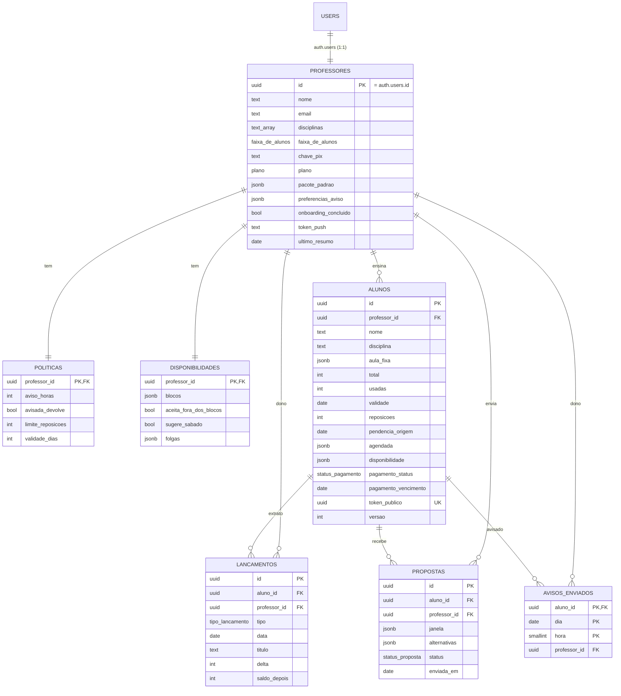

# Aula em Dia — modelo de dados

**Grupo 08** · turma GPE17M80081 · 25/11/2026

O banco é um **PostgreSQL gerenciado pelo Supabase**. A fonte de verdade são as 10 migrações em
`api/supabase/migrations/` (`0001_esquema.sql` a `0010_avisos.sql`). Este documento as descreve.

## 1. Visão geral

**Quem lê e escreve no banco:**

| Quem | Como | O que alcança |
|---|---|---|
| **App do professor** (celular e web) | Supabase Auth + consultas com a chave pública, sob **RLS** | só as linhas do próprio professor |
| **Ações que mexem no saldo** | a função do banco `aplicar_movimento`, numa transação | o aluno e o lançamento, juntos |
| **Página do aluno** (`/a/<token>`) | a Edge Function `aluno-publico`, com a service role | só o recorte daquele aluno, achado pelo token |
| **Lembretes** | o `pg_cron` chama a Edge Function `avisos` | os professores com push ligado e os seus alunos |
| **Apagar conta** | a Edge Function `apagar-conta`, com o login do professor | apaga o usuário, e o cascade apaga o resto |

## 2. Diagrama entidade-relacionamento

No diagrama aparecem as colunas principais. O dicionário abaixo traz todas.

## 3. Dicionário de dados

### `professores`

Um por usuário do Auth. É criado sozinho no cadastro, pelo trigger da `0003`.

| Coluna | Tipo | Obrig. | Padrão | Descrição |
|---|---|---|---|---|
| `id` | uuid | sim | — | chave; o mesmo id de `auth.users`, com `on delete cascade` |
| `nome` | text | sim | `''` | nome do professor |
| `iniciais` | text | sim | `''` | iniciais do avatar |
| `email` | text | sim | — | e-mail da conta |
| `disciplinas` | text[] | sim | `{}` | disciplinas que ensina |
| `faixa_de_alunos` | enum | não | — | quantos alunos tem (`1–5`, `6–15`, `16+`), informado no onboarding |
| `chave_pix` | text | não | — | vai nas mensagens de cobrança |
| `plano` | enum | sim | `gratuito` | `gratuito` (até 5 alunos ativos) ou `pago` |
| `pacote_padrao` | jsonb | não | — | o pacote sugerido ao vender: aulas, valor por aula, validade |
| `preferencias_aviso` | jsonb | não | — | quais lembretes estão ligados |
| `criado_em` | timestamptz | sim | `now()` | |
| `onboarding_concluido` | bool | sim | `false` | `0004`: o onboarding termina uma vez por conta, não por aparelho |
| `token_push` | text | não | — | `0010`: o endereço do aparelho no Expo Push. Nulo até o app publicado gravá-lo |
| `ultimo_resumo` | date | não | — | `0010`: o dia do último resumo das 7h, para não mandar dois |

### `politicas`

A política de faltas, uma por professor.

| Coluna | Tipo | Obrig. | Padrão | Descrição |
|---|---|---|---|---|
| `professor_id` | uuid | sim | — | chave e FK para `professores` (cascade) |
| `aviso_horas` | int ≥ 0 | sim | `24` | o prazo mínimo de aviso, em horas. O app aceita de 1 a 720 |
| `avisada_devolve` | bool | sim | `true` | se a falta avisada no prazo devolve a aula |
| `limite_reposicoes` | int ≥ 0 | sim | `3` | reposições por pacote; `0` = sem limite. O app oferece até 30 |
| `validade_dias` | int ≥ 0 | sim | `60` | a validade padrão do pacote; `0` = sem prazo |

### `disponibilidades`

A agenda do professor, uma por professor.

| Coluna | Tipo | Obrig. | Padrão | Descrição |
|---|---|---|---|---|
| `professor_id` | uuid | sim | — | chave e FK (cascade) |
| `blocos` | jsonb | sim | `[]` | os horários livres da semana (formato abaixo) |
| `aceita_fora_dos_blocos` | bool | sim | `false` | se a reposição pode cair fora desses horários (com pontuação menor) |
| `sugere_sabado` | bool | sim | `false` | se o sábado entra nas sugestões |
| `folgas` | jsonb | sim | `[]` | `[{ de, ate?, motivo }]`, os dias em que nada é sugerido |

**Formato dos horários (`blocos`, e também `alunos.disponibilidade`):**
- São intervalos em **minutos desde a meia-noite, de 15 em 15**:
  `[{ "dia": "seg", "inicio": 870, "fim": 1080 }]` é segunda das 14h30 às 18h.
- O formato anterior, em faixas (`{ "dia": "seg", "faixa": "tarde" }`), continua sendo lido e é
  convertido na carga. Por isso não houve migração.

### `alunos`

| Coluna | Tipo | Obrig. | Padrão | Descrição |
|---|---|---|---|---|
| `id` | uuid | sim | `gen_random_uuid()` | chave |
| `professor_id` | uuid | sim | `auth.uid()` | FK para `professores` (cascade) |
| `nome`, `disciplina` | text | sim | — | |
| `dia`, `hora` | text | sim | — | o horário em texto, como a lista mostra ("terça e quinta", "18h"); é gerado de `aula_fixa` |
| `aula_fixa` | jsonb | não | — | `0009`: a aula semanal (formato abaixo). Nula nas linhas anteriores à `0009` |
| `telefone`, `email` | text | não | — | o telefone monta o link do WhatsApp |
| `total` | int ≥ 0 | sim | `0` | aulas do pacote atual, incluindo o saldo herdado na renovação |
| `usadas` | int ≥ 0 | sim | `0` | aulas debitadas; **`usadas <= total`** (`saldo_nao_negativo`) |
| `validade` | date | não | — | o vencimento do pacote; nula = sem prazo |
| `validade_estendida` | bool | sim | `false` | se a validade já foi estendida (15 dias) |
| `sem_pacote`, `encerrado` | bool, date | — | `false`, — | aluno sem pacote ativo; data em que o último acabou |
| `valor_por_aula_centavos` | int ≥ 0 | não | — | o preço da aula, em centavos |
| `reposicoes` | int | sim | `0` | reposições usadas no pacote, contadas contra o limite da política |
| `pendencia_origem` | date | não | — | a data da falta que gerou uma reposição ainda sem horário |
| `agendada` | jsonb | não | — | a reposição marcada: `{ "dia": "Terça, 10/11", "hora": "14h30" }` |
| `disponibilidade` | jsonb | não | — | quando o aluno pode repor; mesmo formato de `blocos` |
| `pausado` | bool | sim | `false` | aulas pausadas até regularizar |
| `lembretes`, `ultimo_lembrete` | int, date | — | `0`, — | quantas cobranças foram enviadas, e quando |
| `atrasos_historicos` | int | sim | `0` | quantas vezes já atrasou |
| `pagamento_status` | enum | sim | `sem` | `pago`, `aberto`, `atraso` ou `sem` |
| `pagamento_em`, `pagamento_meio` | date, text | não | — | quando e como pagou (Pix, Dinheiro, Transferência) |
| `pagamento_vencimento` | date | não | — | o vencimento; quando passa com o status `aberto`, o app o lê como atraso |
| `arquivado` | bool | sim | `false` | fora da lista, com o histórico guardado |
| `token_publico` | uuid | sim | `gen_random_uuid()` | **único**; é a credencial do link do aluno |
| `versao` | int | sim | `0` | a trava otimista: cada gravação confere e incrementa |
| `criado_em` | timestamptz | sim | `now()` | |

**Formato de `aula_fixa`:** `{ "dias": ["seg","qua"], "hora": 15, "minuto": 15, "duracao": 90,
"porDia": { "qua": 1050 } }`, que é segunda às 15h15 e quarta às 17h30, 90 minutos cada.
- `hora` é sempre a hora cheia do primeiro dia, a única coisa que o `check` exige: `dias` só com
  dias válidos e `hora` inteira de 0 a 23, ou nula.
- `minuto`, `duracao` (padrão 60) e `porDia` (o começo de cada dia que foge do horário geral, em
  minutos) são opcionais.

### `lancamentos` (o extrato)

**Só aceita inserir.** Um lançamento nunca é alterado nem apagado, e é isso que torna o extrato
auditável.

| Coluna | Tipo | Obrig. | Padrão | Descrição |
|---|---|---|---|---|
| `id` | uuid | sim | `gen_random_uuid()` | chave |
| `aluno_id` | uuid | sim | — | FK para `alunos` (cascade) |
| `professor_id` | uuid | sim | — | FK para `professores` (cascade) |
| `tipo` | enum | sim | — | `aula`, `falta_avisada`, `falta_sem_aviso`, `cancelada_professor`, `reposicao`, `pagamento`, `pacote`, `validade`, `proposta`, `legado` |
| `data` | date | sim | — | o dia do fato |
| `titulo`, `subtitulo` | text | sim | —, `''` | o que o extrato mostra: "Falta avisada" · "Aviso com 26h · reposição gerada" |
| `delta` | int | sim | — | o efeito no saldo (−1, 0 ou as aulas do pacote) |
| `saldo_depois` | int ≥ 0 | sim | — | o saldo depois do lançamento |
| `dinheiro` | bool | sim | `false` | lançamento financeiro (pagamento) |
| `criado_em` | timestamptz | sim | `now()` | a ordem do extrato; índice `(aluno_id, criado_em desc)` |

### `propostas`

As propostas de reposição enviadas ao aluno pelo link.

| Coluna | Tipo | Obrig. | Padrão | Descrição |
|---|---|---|---|---|
| `id` | uuid | sim | `gen_random_uuid()` | chave |
| `aluno_id`, `professor_id` | uuid | sim | — | FKs (cascade) |
| `janela` | jsonb | sim | — | o horário proposto: `{ "dia": "Terça, 10/11", "hora": "14h30" }` |
| `alternativas` | jsonb | sim | `[]` | as outras sugestões, que o aluno pode escolher: `[{ dia, hora, motivo }]` |
| `status` | enum | sim | `enviada` | `enviada`, `aceita`, `recusada` ou `confirmadaPeloProfessor` |
| `enviada_em` | date | sim | — | |
| `respondida_em` | timestamptz | não | — | quando o aluno respondeu |

**Uma proposta aberta por aluno**, pelo índice único parcial `uma_proposta_aberta (aluno_id) where
status = 'enviada'`.

### `avisos_enviados`

Criada na `0010`. Garante que cada aviso de aula saia uma vez só.

| Coluna | Tipo | Obrig. | Descrição |
|---|---|---|---|
| `aluno_id` | uuid | sim | FK para `alunos` (cascade) |
| `professor_id` | uuid | sim | FK para `professores` (cascade) |
| `dia` | date | sim | o dia da aula, em Brasília |
| `hora` | smallint 0–23 | sim | a hora cheia da aula |
| `enviado_em` | timestamptz | sim | `now()` |

A **chave primária é `(aluno_id, dia, hora)`**: a função insere com `on conflict do nothing` e só
manda o push se a linha entrou.

## 4. Tipos enumerados

| Tipo | Valores |
|---|---|
| `faixa_de_alunos` | `1–5`, `6–15`, `16+` |
| `plano` | `gratuito`, `pago` |
| `status_pagamento` | `pago`, `aberto`, `atraso`, `sem` |
| `status_proposta` | `enviada`, `aceita`, `recusada`, `confirmadaPeloProfessor` |
| `tipo_lancamento` | `aula`, `falta_avisada`, `falta_sem_aviso`, `cancelada_professor`, `reposicao`, `pagamento`, `pacote`, `validade`, `proposta`, `legado` |

## 5. Integridade

- **Chaves estrangeiras com `on delete cascade`** em toda a cadeia, a partir de `auth.users`: apagar
  o usuário apaga o professor, a política, a disponibilidade, os alunos, o extrato, as propostas e os
  avisos.
- **`check`s:**
  - contadores e valores nunca negativos;
  - `usadas <= total`, para o saldo nunca ficar negativo;
  - `saldo_depois >= 0`;
  - a `aula_fixa` válida (`0009`);
  - a `hora` do aviso entre 0 e 23.
- **Únicos:**
  - o `token_publico` de cada aluno;
  - uma proposta aberta por aluno;
  - um aviso por aluno, dia e hora.
- **Trava otimista** (`versao`, `0005`): o app manda a versão que leu. Se outro aparelho gravou
  antes, a gravação é recusada com `conflito_de_versao`, e o app recarrega em vez de sobrescrever.
- **Um horário aceita uma reposição só** (`0007`): o aceite do aluno é recusado com
  `horario_ocupado` quando outro aluno do mesmo professor já tem reposição naquele dia e hora. Os
  aceites de um professor passam por uma trava de transação (`pg_advisory_xact_lock`), então dois
  aceites simultâneos não passam juntos.

## 6. Segurança: RLS e perfis de acesso

**A RLS está ligada em todas as 7 tabelas.** As políticas são estas:

| Tabela | Política | Regra |
|---|---|---|
| `professores` | "o próprio perfil" | `id = auth.uid()` |
| `politicas`, `disponibilidades` | "a própria …" | `professor_id = auth.uid()` |
| `alunos` | "os próprios alunos" | `professor_id = auth.uid()`, em leitura e escrita |
| `lancamentos` | "lê o próprio extrato" e "insere no próprio extrato" | só `select` e `insert`, e o insert exige que o aluno seja do professor. **Sem update nem delete** |
| `propostas` | "as próprias propostas" (`0008`, estrita) | o professor só cria e altera propostas de alunos **dele** |
| `avisos_enviados` | "lê os próprios avisos" | só leitura; quem escreve é a função, com a service role |

**Os perfis:**
- **Professor:** autenticado pelo Supabase Auth. Tudo o que faz passa pela RLS.
- **Aluno:** **não tem conta nem acesso ao banco.**
  - A página dele chama a Edge Function `aluno-publico`, que procura o aluno pelo `token_publico` e
    devolve só o recorte daquele aluno: saldo, extrato, regra combinada e proposta aberta.
  - Um token inválido, antigo ou de aluno arquivado recebe 404 sem corpo.
  - O professor gera um token novo com `novo_link_do_aluno` (`0006`), e o link antigo para de
    funcionar.
- **Rotinas do servidor:** usam a service role, que nunca sai do servidor. Ela não está no app, no
  repositório nem nas variáveis públicas.

## 7. Funções do banco

| Função | Migração | O que faz |
|---|---|---|
| `criar_professor()` (trigger `ao_criar_usuario`) | `0003` | no cadastro (`after insert on auth.users`), cria o professor, a política e a disponibilidade com os padrões. É `security definer` |
| `aplicar_movimento(aluno, versao, lancamento, proposta)` | `0005`, `0007` | a **escrita transacional** de toda ação que mexe no saldo: atualiza o aluno, insere o lançamento e cria ou responde a proposta, conferindo a versão e o horário ocupado. Devolve a nova versão. Só para `authenticated` |
| `novo_link_do_aluno(aluno)` | `0006` | troca o `token_publico`, e o link antigo morre. Só para `authenticated` |
| `chamar_avisos(tipo)` | `0010` | chamada pelo `pg_cron`; aciona a Edge Function `avisos` pelo `pg_net`, com o endereço e o segredo guardados no Vault |

## 8. Edge Functions

Elas ficam em `api/supabase/functions/` e importam as regras do app, empacotadas a partir de
`app/src/dominio/`.

| Função | Acesso | Lê | Escreve |
|---|---|---|---|
| `aluno-publico` | público, pelo token do link | o aluno, o extrato, a política e a proposta aberta | a resposta à proposta (aceite vira reposição marcada) e a disponibilidade que o aluno informa, validada: múltiplos de 15 minutos, no máximo 336 intervalos |
| `avisos` | só com o segredo do `pg_cron` | professores com push e seus alunos | `ultimo_resumo` e `avisos_enviados`; manda o push pelo Expo Push |
| `apagar-conta` | o próprio professor, com login | o usuário | apaga o usuário do Auth, e o cascade apaga o resto |

## 9. Rotinas agendadas (`pg_cron`, `0010`)

| Agendamento | Quando | O que faz |
|---|---|---|
| `avisos-resumo` | todo dia às 10h UTC (7h em Brasília) | o resumo do dia: aulas de hoje, saldos baixos, reposições sem horário, pagamentos vencendo |
| `avisos-aula` | toda hora cheia | o aviso uma hora antes de cada aula |

## 10. O que o banco não guarda, e por quê

| Dado | Onde fica |
|---|---|
| O **saldo** | `total − usadas`, calculado. Guardá-lo seria ter duas fontes que podem divergir |
| O **atraso** de um pacote aberto vencido | derivado de `pagamento_vencimento` na carga; a próxima gravação leva o status para o banco |
| As **aulas compradas** quando a renovação somou o saldo | refeitas pelo lançamento "Pacote de N aulas"; é por elas que se cobra |
| O **"hoje"** de cada aluno | calculado da `aula_fixa` e da data |

## 11. Histórico das migrações

| Migração | O que fez |
|---|---|
| `0001_esquema` | os 5 tipos e as 6 tabelas iniciais |
| `0002_rls` | a RLS em todas as tabelas, com as políticas por professor |
| `0003_novo_professor` | o trigger que cria professor, política e disponibilidade no cadastro |
| `0004_onboarding` | `professores.onboarding_concluido` |
| `0005_aplicar_movimento` | a escrita transacional com a trava de versão |
| `0006_link_do_aluno` | a troca do link do aluno |
| `0007_horario_ocupado` | um horário aceita uma reposição só |
| `0008_propostas_estrita` | proposta só para aluno do próprio professor |
| `0009_aula_fixa` | `alunos.aula_fixa`, com o `check` |
| `0010_avisos` | `token_push`, `ultimo_resumo`, `avisos_enviados` e os dois agendamentos |

**Testes do banco** (pgTAP, em `api/supabase/tests/database/`): RLS com dois professores,
`aplicar_movimento`, horário ocupado, link do aluno, aula fixa, avisos, apagar conta, novo professor
e propostas estritas. Rodam no CI a cada push.
