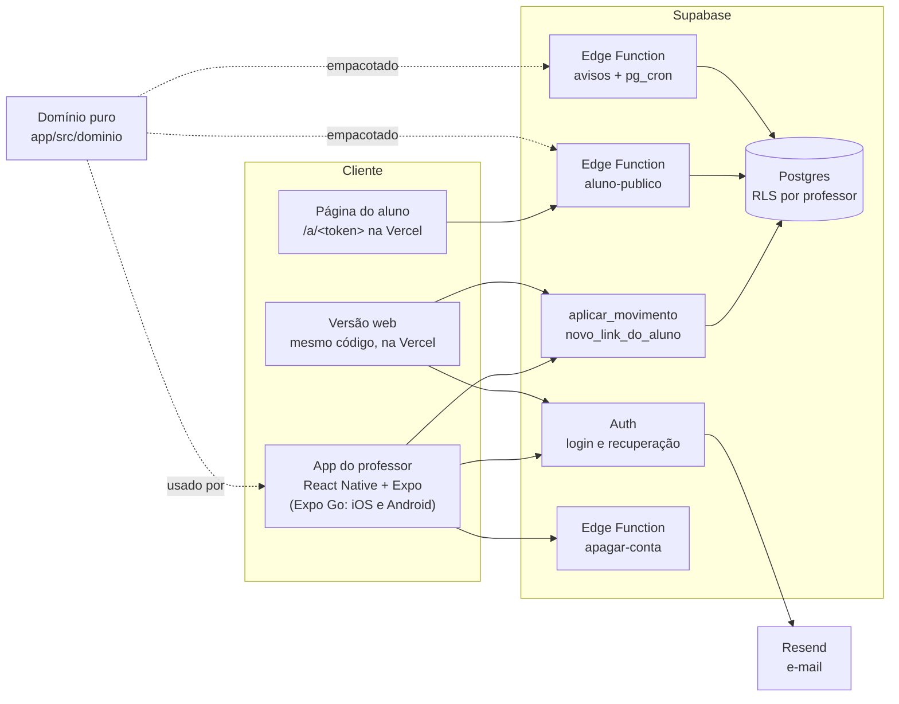

# Aula em Dia — o projeto

**Grupo 08** · Soluções Computacionais · Universidade Católica de Brasília · turma GPE17M80081 · 2026/2

Integrantes, em ordem alfabética: Mauro Schulz (UC22201123), Rafael Dornelas (UC23101280) e Valentin
Klein Antunes (UC23100774).

> Falta e reposição de aula particular, resolvidas sem discussão. O concorrente resolve o saldo;
> nós resolvemos o que vem depois.

---

## 1. Resumo

O Aula em Dia é um aplicativo para o **professor particular** que vende pacotes de aulas pagos
antecipadamente. A política de faltas é definida uma vez pelo professor, e o app passa a aplicá-la
sozinho. O motivo de cada débito fica num extrato que o **aluno também vê**, por um link. Quando nasce
o direito a uma reposição, o app devolve os melhores horários prontos, calculados contra a agenda real
de todos os alunos, cada um com o motivo da sugestão.

São um aplicativo (React Native + Expo) e a versão web do mesmo código, as duas sobre um backend no
Supabase. Ficaram prontas 37 telas, nos temas claro e escuro, e 1330 testes automatizados no app,
além dos testes do banco e das funções.

## 2. O problema e as dores

Professores de idiomas, reforço escolar e instrumento musical quase sempre trabalham com **pacotes de
aulas pagos adiantado**. Quando o aluno falta, começam duas dores encadeadas.

**1. O saldo.** A falta consome ou não uma aula do pacote? A resposta depende de uma política que
existe só na cabeça do professor: "se avisou com antecedência a gente remarca, se sumiu perdeu". Como
a regra não está registrada em lugar nenhum, o fim do mês vira discussão. O aluno diz que ainda tem
duas aulas, o professor tem certeza de que o pacote acabou, e nenhum dos dois consegue provar.

**2. A reposição**, a dor maior e a que ninguém resolve. É preciso achar um horário que:
- sirva ao professor e ao aluno;
- não colida com as aulas fixas dos outros alunos nem com reposições já marcadas;
- caia antes de o pacote vencer.

Hoje isso custa **dez mensagens de WhatsApp por falta** e muitas vezes acaba em **reposição
esquecida**: aula paga e não dada, pacote que vence, cliente insatisfeito.

**As dores, por quem sente:**

| Quem | Dor |
|---|---|
| Professor | Não ter como provar quantas aulas restam; negociar reposição por mensagem; esquecer reposições e cobranças; cobrar sem constrangimento; registrar tudo com pressa, entre uma aula e outra, com uma mão |
| Aluno ou responsável | Não saber o próprio saldo; não entender por que uma falta foi debitada; perder a reposição por falta de horário |

**A tese do produto:** o saldo do pacote é o problema fácil, basta subtrair um, e por isso todo
concorrente já o resolve. A reposição é um **agendamento com restrições**, específico de ensino, e
está em aberto. É nela que o produto foi construído.

## 3. Público, mercado e concorrência

**Público inicial:** o professor particular autônomo de aula individual. Depois, escolas de música e
microescolas de idiomas, onde a reposição ainda envolve sala e professor substituto. O **aluno** usa
o produto sem pagar e é o canal de divulgação.

**Mercado.** Pelos registros de CNAE da Receita Federal:
- o código 8599-6/99 (aulas particulares e reforço) reúne cerca de **685 mil empresas**;
- o ensino de idiomas tem **92 mil**;
- o ensino de música tem **42 mil**, das quais 21.569 ativas;
- somam-se os professores informais, sem CNPJ.

**Concorrência** (levantamento de agosto de 2026, detalhado na
[proposta](propostas/Envio01-AulaEmDia.pdf)):

| Produto | O que resolve | O que não resolve |
|---|---|---|
| Mensio | saldo descontado na presença, Pix, lembretes | regra única (marcou presença, debita); trata reposição como venda avulsa; não agenda |
| EnsinaApp | pacotes de 4 ou 8 aulas, voucher de remarcação | voucher com regra fixa; não busca o horário |
| eClasse | pacotes, portal do cliente, cobrança | sem política de faltas, sem reposição; caro para o segmento |
| iProfe | cadastro, agenda, pagamentos | sem saldo de pacote, sem reposição |
| WebMúsica, GECEM | gestão de escola (matrícula, turma, boleto) | software de secretaria, sem pacote individual |

Todos convergem para o saldo, e nenhum avança para a reposição. O motivo é estrutural: o concorrente
mais forte atende dezoito segmentos com o mesmo produto, e uma regra como "aviso com 24 h devolve a
aula" não faz sentido para locação de equipamentos. **O Aula em Dia é vertical:** a política de faltas
é do professor, e a reposição vira horários prontos.

## 4. A solução

### Princípios

1. **A regra decide, não a discussão.** Todo débito tem motivo registrado e visível ao aluno.
2. **O efeito aparece antes da ação.** O professor vê o que acontece com o saldo antes de confirmar.
3. **Atenção primeiro onde está o dinheiro.** Atraso, reposição pendente e saldo baixo sobem para o
   topo.
4. **Rápido no fim da aula.** O caminho mais usado cabe em dois toques.
5. **Toda sugestão tem motivo.** Uma janela de reposição sempre diz por que foi sugerida.

### Os fluxos (37 telas)

O app tem três abas: **Alunos**, **Financeiro** e **Ajustes**. A tela inicial abre no saldo, não na
agenda.

| Fluxo | O que cobre |
|---|---|
| **A. Entrada e onboarding** | Boas-vindas, login e cadastro, recuperação de senha por e-mail, e 4 passos guiados: perfil, disponibilidade, política e primeiro aluno com pacote |
| **B. Alunos e registro** | A lista ordenada por urgência, com o lembrete das aulas de hoje sem registro. A ficha com saldo e extrato. **Registrar aula** com os 4 desfechos e o efeito no saldo antes de confirmar. O resultado |
| **C. Reposição** | Um assistente em 3 passos: a disponibilidade do aluno, as melhores sugestões com o motivo (ou outro horário, ou as saídas quando nada serve) e a confirmação com a mensagem pronta. Depois, o aguardo do aceite do aluno |
| **D. Pacote e financeiro** | Novo pacote ou renovação (somando ou não o saldo), o painel do mês, a cobrança de quem atrasou, o registro de pagamento e o lembrete de cobrança em 3 tons |
| **E. Ajustes** | Perfil, a grade de disponibilidade, a política de faltas, o pacote padrão, os avisos, a chave Pix e a conta (plano, alterar a senha, exportar dados, apagar a conta) |
| **F. Visão do aluno** | A página do link, sem instalar nada: saldo, extrato, a regra combinada, as propostas de reposição (aceitar ou recusar) e a disponibilidade dele, marcada numa grade |

## 5. As regras de negócio

As regras moram em `app/src/dominio/`: são **funções puras**, sem tela, banco nem rede, e cada uma
tem testes. A interface só mostra o que elas decidem.

### 5.1 Política de faltas

O professor configura quatro coisas:
- o **prazo mínimo de aviso**, de 1 a 720 horas (um professor online pode aceitar 1 h);
- se a **falta avisada devolve a aula**;
- o **limite de reposições por pacote**, de 1 a 30, ou sem limite;
- a **validade** do pacote.

Ao registrar uma aula, o professor escolhe o desfecho e digita a antecedência real do aviso:

| Desfecho | Efeito no saldo | Reposição |
|---|---|---|
| Aula realizada | debita 1 | — |
| Falta avisada, dentro do prazo | não debita | gera o direito |
| Falta avisada, dentro do prazo, com o **limite de reposições já usado** | debita 1 | não gera |
| Falta avisada, fora do prazo, ou política que não devolve | debita 1 | não gera |
| Falta sem aviso | debita 1 | não gera |
| Aula cancelada pelo professor | não debita | gera **sempre**, sem contar no limite do aluno |

Mais três regras completam o registro:
- **No dia da reposição marcada**, registrar "aula realizada" grava **"Reposição realizada"** e fecha
  a reposição.
- **Se o dia da reposição passou sem registro**, ela volta a aparecer como pendência.
- **Com o saldo zerado**, o app avisa antes de registrar e oferece renovar o pacote. A aula ainda pode
  ser registrada, porque aconteceu, mas o extrato marca "sem saldo no pacote".

### 5.2 O motor de reposição (`agenda.ts`)

Para cada dia, do dia seguinte até a validade do pacote, o motor testa cada começo **de 15 em 15
minutos**, com a **duração da aula do aluno**. Ele descarta o horário que:
- está fora da disponibilidade do professor, a menos que ele aceite reposição fora dela;
- não cabe na disponibilidade que o aluno marcou, quando ele marcou alguma;
- colide com a aula fixa de outro aluno (cada aluno tem dias, **um horário por dia** e duração) ou
  com uma reposição já marcada naquela data;
- cai em folga, feriado ou sábado (o sábado só fica de fora quando o professor desligou "Sugerir
  sábados").

O que sobra é pontuado, e **cada ponto vira o motivo em texto**:

| Critério | Pontos | Motivo mostrado |
|---|---|---|
| Quanto antes, melhor | base de 100 menos os dias até a data | "Acontece N dias antes do pacote vencer" |
| Mesmo horário da aula do aluno | +40 | "No mesmo horário da aula dele." |
| Horário que o aluno marcou como disponível | +25 | "Ele marcou esse horário como disponível." |
| Colado em outra aula | +10 | "Encaixa logo antes ou depois de outra aula." |
| Fora dos horários habituais do professor | −30 | "Está fora dos seus horários habituais." |

Para a lista não virar um relógio, o motor guarda **um começo por trecho livre** e no máximo 3 por
dia. Quando nada serve, ele explica por quê ("Você ainda não marcou nenhum horário na sua
disponibilidade") e oferece as saídas: outro horário, estender a validade ou dispensar a reposição.

### 5.3 Pacote e pagamento

- **Pacote:** quantidade de aulas, valor por aula e validade (30, 60 dias ou sem prazo). Na renovação,
  o saldo anterior pode ser somado. **Cobra-se só pelas aulas compradas:** as herdadas já foram pagas.
- **Pagamento:** começa "em aberto", com vencimento. Quando o vencimento passa sem pagamento, ele vira
  **atraso**, sozinho e com os dias contados. Registrar o pagamento (Pix, dinheiro ou transferência)
  quita e lança no extrato.
- **Saldo baixo** (2 aulas ou menos) e **pacote perto de vencer** (7 dias, com aula sobrando) aparecem
  em âmbar. **Pacote vencido** com aula sobrando aparece em vermelho.

### 5.4 A ordem de atenção

A lista de alunos ordena por urgência, nesta ordem:
1. pagamento em atraso;
2. reposição pendente;
3. o resto, por saldo.

Cada aluno mostra **um selo só**, na precedência: pausado, atraso, reposição pendente (ou esquecida),
pacote vencido, pacote vencendo, reposição marcada.

### 5.5 Mensagens e lembretes

- **Mensagens prontas** para o WhatsApp:
  - a proposta de reposição, que só explica a regra combinada na primeira reposição do pacote;
  - a cobrança, em três tons (cordial, direto, formal), com a chave Pix.
- **Na tela inicial:** as aulas de hoje que **já terminaram e não foram registradas**, com o atalho
  para registrar. Registrar toda aula é o hábito do qual o saldo depende.
- **Por push:** o resumo das 7h e o aviso uma hora antes da aula. As regras estão no domínio e a
  função no servidor (`avisos`, com `pg_cron`), mas o envio só começa quando o app publicado gravar o
  endereço do aparelho.

## 6. Perfis de acesso e privacidade

| Perfil | Como entra | O que pode |
|---|---|---|
| **Professor** | e-mail e senha (Supabase Auth); recuperação por e-mail e troca de senha nos Ajustes, conferindo a senha atual | tudo o que é dele, e só o que é dele |
| **Aluno ou responsável** | **sem conta:** o link `/a/<token>` que o professor manda | ver o próprio saldo, o extrato e a regra combinada; aceitar ou recusar propostas; informar quando pode repor |

**Como isso é garantido:**
- **No banco, pela RLS.** Cada tabela só deixa o professor ler e escrever as linhas dele. Isso é
  testado com dois professores, para provar que um não vê o outro.
- **O extrato é só de inserção.** Um lançamento nunca é editado nem apagado, e é isso que o torna
  auditável.
- **O aluno não fala com o banco.** A página chama a função `aluno-publico`, que devolve só o recorte
  daquele aluno. Um token inválido, antigo ou de aluno arquivado recebe 404, sem dizer por quê. O
  professor pode trocar o link a qualquer momento.
- **A conta pode ser apagada pelo próprio professor**, com tudo o que é dele (função `apagar-conta`).

## 7. Arquitetura

- **Um código, três superfícies.** O app do professor, a versão web e a página do aluno saem do mesmo
  projeto Expo. A web é o export para navegador, publicado na Vercel a cada push na `main`.
- **O domínio é a fonte única das regras.** As funções do servidor importam o mesmo domínio do app,
  empacotado: a página do aluno e os lembretes aplicam exatamente as regras que o professor vê.
- **Escrita transacional.** Cada ação que mexe no saldo, como registrar aula, marcar reposição ou
  receber pagamento, vai para o banco numa única chamada (`aplicar_movimento`), com o aluno e o
  lançamento juntos. Uma trava de versão impede dois aparelhos de se sobrescreverem.
- **Dois modos.** No modo **local** o app roda sem backend, com dados de demonstração no aparelho; é o
  modo para avaliar sem conta. No modo **supabase** há login real e os dados ficam na nuvem, com um
  cache para abrir rápido.

O modelo de dados completo está em [DADOS.md](DADOS.md).

## 8. Design e acessibilidade

- **Direção visual iOS Glass:** material de vidro sobre um fundo de refração, um único tom de
  destaque, status sempre como fundo suave com texto escuro, um botão primário por tela, números
  tabulares e temas **claro e escuro**. As 37 telas seguem o mesmo sistema, documentado em tokens e
  num catálogo vivo de componentes.
- **Acessibilidade**, documentada em `spec/acessibilidade.md`:
  - contraste medido;
  - alvos de toque de pelo menos 44 px (48 px no Android e nas abas);
  - rótulos para leitor de tela (o saldo é anunciado inteiro, a cor nunca é o único sinal);
  - fonte dinâmica sem cortar texto;
  - reduzir movimento;
  - o tema do sistema na primeira abertura.
- **A grade de horários** se pinta com o dedo: um toque marca 1 hora, segurar e arrastar marca de 15
  em 15 minutos. Ela tem um caminho equivalente pelo teclado, para quem usa leitor de tela.

## 9. Qualidade e processo

**Testes automatizados:**
- **App:** 1330 testes em 50 suítes. Cobrem:
  - as regras do domínio, com os casos tabelados em `spec/casos-de-teste.md`;
  - a navegação;
  - a montagem das 37 telas;
  - os fluxos de ponta a ponta;
  - a conversão para o banco.
- **Banco:** testes pgTAP para a RLS, as RPCs, a trava de horário, a aula fixa e os avisos.
- **Funções:** testes da página do aluno, dos avisos e da recuperação de senha.

**Integração contínua** a cada push e PR, com três verificações:
- testes, tipos e lint;
- a RLS do banco;
- a função do aluno.

A `main` é protegida e só aceita merge com o CI verde.

**Processo:**
- **Scrum no Jira:** 13 sprints entre 07/10 e 25/11, com cards num modelo de 9 seções.
- **Três camadas, três donos:**
  - apresentação: Rafael, também PO e Scrum Master;
  - regras e portões: Mauro;
  - persistência: Valentin.
- Um commit por camada, PR com review cruzado e convenção `SCRUM-nn:`.
- Mais de 400 commits e 60 PRs mesclados desde 08/09.
- **Revisões de design** em rodadas, cada uma com relatório, capturas antes e depois e aprovação.

## 10. Limitações conhecidas

O que o produto **ainda não faz**, para que nada seja apresentado como pronto sem estar:
- **O app não está nas lojas.** Roda pelo Expo Go e pela versão web.
- **O push ainda não chega ao aparelho.** O servidor está pronto, mas falta o app publicado gravar o
  endereço do aparelho.
- **A assinatura não é cobrada.** A tela de Conta mostra o plano gratuito (até 5 alunos) e o pago
  (R$ 29,90/mês), mas não há meio de pagamento integrado.
- **Só pacote pré-pago, aula individual.** Não há mensalidade, aula avulsa, turma nem o responsável
  como contato separado.
- **Uma reposição de cancelamento do professor aceita pela página do aluno** ainda conta no limite do
  aluno. Pelo app do professor, não conta.
- **O cadastro inicial é manual:** não há importação de alunos.

## 11. Próximos passos

Em ordem de impacto:
1. **Publicar na Play Store** (build pelo EAS) e ligar o push: o aviso "como foi a aula?" logo depois
   do horário é o motor do hábito de registrar.
2. **Outros modelos de cobrança:** mensalidade e aula avulsa, ao lado do pacote.
3. **O responsável do aluno:** nome e telefone de quem paga e recebe as mensagens.
4. **Importar alunos** da agenda do celular ou de uma planilha.
5. **Turmas:** uma aula com vários alunos, cada um com o próprio saldo.
6. **Escolas:** vários professores, sala e professor substituto no motor de reposição.
7. **Acessibilidade:** respeitar o "reduzir transparência" do sistema e tornar a versão web
   instalável.

O backlog detalhado está em `PROXIMOS-PASSOS.md`, dentro de [projeto/](projeto/).
