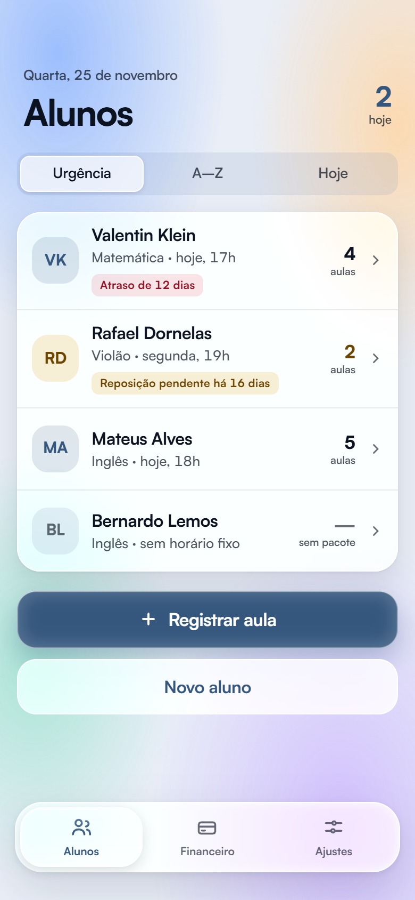
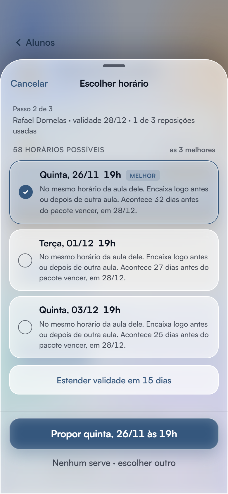
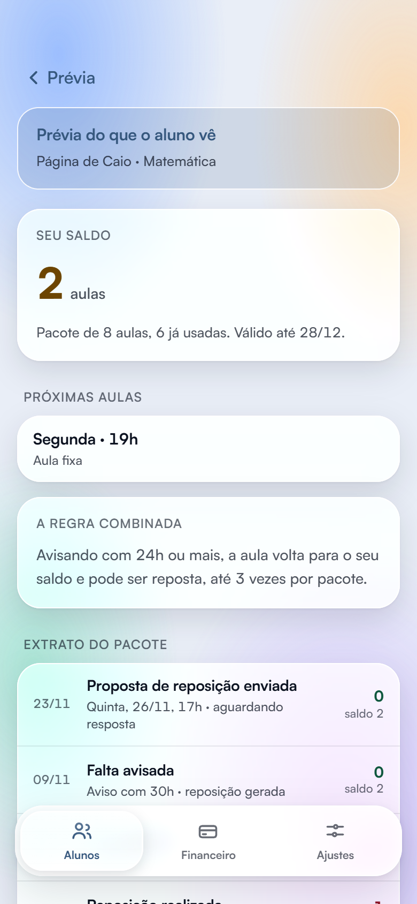

# Aula em Dia — Grupo 08

Soluções Computacionais · Universidade Católica de Brasília · 2026/2

## Integrantes

| Nome completo | Matrícula | Turma |
|---|---|---|
| Mauro Schulz | UC22201123 | GPE17M80081 |
| Rafael Dornelas | UC23101280 | GPE17M80081 |
| Valentin Klein Antunes | UC23100774 | GPE17M80081 |

**Vídeo de apresentação (YouTube, não listado):** _a preencher com o link_

---

## O projeto

Professores particulares de idiomas, reforço escolar e instrumento musical vendem pacotes de aulas
pagos adiantado. Quando o aluno falta, começam duas dores:
- **Saber se a falta consome uma aula do pacote.** A regra existe só na cabeça do professor.
- **Encontrar um horário de reposição.** Ele precisa servir aos dois, não colidir com os outros
  alunos e cair antes de o pacote vencer.

Hoje isso custa a discussão mensal sobre quantas aulas restam e dez mensagens de WhatsApp por
falta. Muitas vezes termina em reposição esquecida: aula paga e não dada.

O **Aula em Dia** resolve o que vem depois da falta:
- **A política de faltas é aplicada sozinha.** O professor a define uma vez, e o app registra o
  motivo de cada débito num extrato que o aluno também vê.
- **A reposição vira horários prontos.** Eles são calculados contra a agenda real e vêm com o
  motivo de cada sugestão.

Os concorrentes resolvem o saldo; nós resolvemos o que vem depois.

O documento completo está em **[PROJETO.md](PROJETO.md)** ([PDF](PROJETO.pdf)): dores, solução,
regras de negócio, arquitetura, qualidade e próximos passos.

## As aplicações

| Pasta | O que é |
|---|---|
| [`app/`](../app/README.md) | O aplicativo do professor, em React Native + Expo, que roda no Expo Go (iOS e Android). |
| [`web/`](../web/README.md) | A mesma aplicação compilada para o navegador, publicada em **https://aula-em-dia-three.vercel.app**. É também onde mora a **página do aluno** (`/a/<token>`). |
| [`api/`](../api/README.md) | O backend no Supabase: banco Postgres com regras de acesso (RLS), as funções do banco e as Edge Functions. As duas aplicações usam a mesma API. |

**Não há aplicação desktop.** O professor usa o app no celular, quase sempre no fim da aula. Quem
prefere o computador usa a versão web, que é o mesmo código.

**Perfis de acesso:**
- **Professor:** entra com e-mail e senha e só enxerga os próprios alunos.
- **Aluno (ou responsável):** não tem conta. Abre o link que o professor manda e, por ele, vê o
  saldo, o extrato e as propostas de reposição, e informa quando pode repor.

## Sugestão de avaliação: como testar

Há dois caminhos, conforme o que se quer ver.

### 1. Em produção: os dois perfis na mesma API (cerca de 10 minutos)

Só precisa de um navegador. É o caminho que mostra o app de verdade: login real, dados na nuvem,
e o professor e o aluno conversando pela mesma API, cada um com as próprias permissões.

**Como professor** (em https://aula-em-dia-three.vercel.app):
1. Toque em **Criar conta** e use qualquer e-mail e uma senha de 6 caracteres ou mais.
2. Siga o onboarding em 4 passos: o seu perfil, a sua disponibilidade (pinte os horários na
   grade), a sua política de faltas e o primeiro aluno, com um pacote de aulas.
3. Na lista de **Alunos**, abra o aluno e toque em **Registrar aula**. Escolha **Falta avisada** e
   digite a antecedência: o efeito no saldo aparece **antes** de confirmar, conforme a sua
   política.
4. No resultado, toque em **Escolher horário**: o app sugere os melhores horários de reposição,
   cada um com o motivo. Escolha um, toque em **Propor** e, no último passo, em **Confirmar e
   avisar o aluno**.
5. Na ficha do aluno, toque em **Copiar link do aluno**.

**Como aluno** (cole o link numa **janela anônima** ou em outro navegador, sem login):

6. A página mostra só o que é desse aluno: saldo, extrato, a regra combinada e a proposta de
   reposição.
7. Toque em **Aceitar** a proposta, e depois marque na grade os horários em que pode repor e envie.

**De volta como professor:**

8. Atualize a página. A reposição aparece como **marcada** e a disponibilidade do aluno chegou:
   tudo passou pela mesma API.
9. Para ver as permissões: na ficha do aluno, **Gerar novo link** (toque duas vezes). O link
   antigo para de funcionar na hora.

### 2. Sem conta e sem internet: a partir deste zip (cerca de 2 minutos)

Para navegar pelo app com dados de demonstração prontos, sem criar nada:

```bash
cd web
npx serve -s dist
```

Abra o endereço que aparecer. Em **Entrar**, use qualquer e-mail com uma senha de 6 caracteres ou
mais: o app abre com 4 alunos de demonstração, cada um num estado diferente:
- um com pagamento em atraso;
- um com reposição pendente e saldo baixo;
- um em dia;
- um sem pacote.

Vale experimentar:
- **Registrar aula**, com os quatro desfechos;
- a **reposição**;
- o **Financeiro**, com a cobrança pronta para o WhatsApp;
- os **Ajustes**: política de faltas, disponibilidade e pacote padrão.

Nesse modo não há login real nem página do aluno, que dependem da API: para isso vale o caminho 1.

**O código-fonte e os testes** estão em [`app/`](../app/README.md): `npm install` e `npm test`
rodam os 1330 testes automatizados das regras de negócio e das telas.

## Como executar

Cada aplicação tem um README próprio, que começa pelos pré-requisitos, pelas dependências, pelas
variáveis de ambiente e pelos comandos:
- [`app/README.md`](../app/README.md): o app no celular (Expo Go) ou no navegador. Roda sem backend,
  no modo local, com dados de demonstração.
- [`web/README.md`](../web/README.md): servir a versão web já compilada, ou compilar de novo.
- [`api/README.md`](../api/README.md): subir o banco e as funções localmente (Docker) e rodar os
  testes.

## Prints

| Alunos | Reposição | Página do aluno |
|---|---|---|
|  |  |  |
| Quem precisa de atenção aparece primeiro: atraso, reposição pendente, saldo baixo. | As melhores sugestões de horário, cada uma com o motivo, calculadas contra a agenda real. | O que o aluno vê pelo link, sem instalar nada: saldo, extrato e a regra combinada. |

## Documentos

| Documento | O que tem |
|---|---|
| [PROJETO.md](PROJETO.md) · [PDF](PROJETO.pdf) | O projeto completo: problema, solução, regras, arquitetura, qualidade e limitações |
| [BMC.md](BMC.md) | O Business Model Canvas, atualizado pelo que foi construído |
| [DADOS.md](DADOS.md) · [PDF](DADOS.pdf) | O modelo de dados: diagrama ER, dicionário, regras de acesso e funções |
| [propostas/](propostas/) | As entregas anteriores: a proposta (Envio 01) e a entrega de 25/09 |
| [backend/](backend/) | O plano do backend em 8 partes (`PLANO-BACKEND.md`, com os diagramas em Mermaid) |
| [design/](design/) | O plano do redesign *iOS Glass*, o mapa das 37 telas e os relatórios das revisões de design |
| [jira/](jira/) | O quadro Scrum: papéis, sprints e o backlog inicial |
| [projeto/](projeto/) | Os arquivos editáveis de especificação: o handoff de design (protótipos), `spec/` (regras, navegação, acessibilidade, casos de teste), `tokens/`, `PRODUCT.md`, `DESIGN.md` e os dados de demonstração |

**Sobre as propostas do semestre anterior:** este grupo se formou em 2026/2. O grupo do primeiro
semestre de 2026 foi desfeito por uma mudança de sala, e o projeto começou do zero neste semestre,
como foi apresentado ao professor. Por isso a primeira proposta é o
[Envio 01](propostas/Envio01-AulaEmDia.pdf), de setembro de 2026, e não há proposta anterior a ela.
