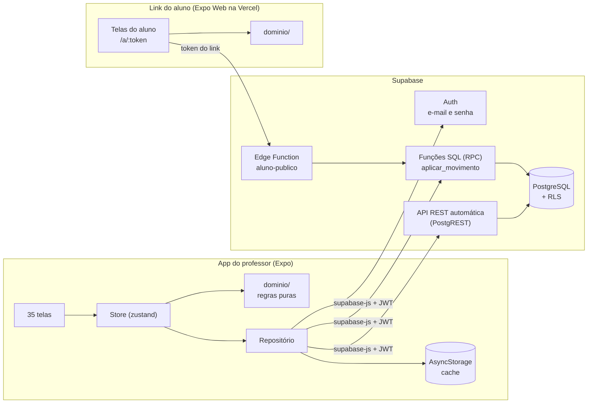
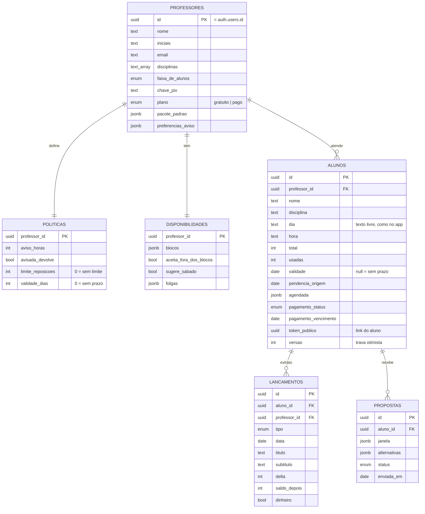
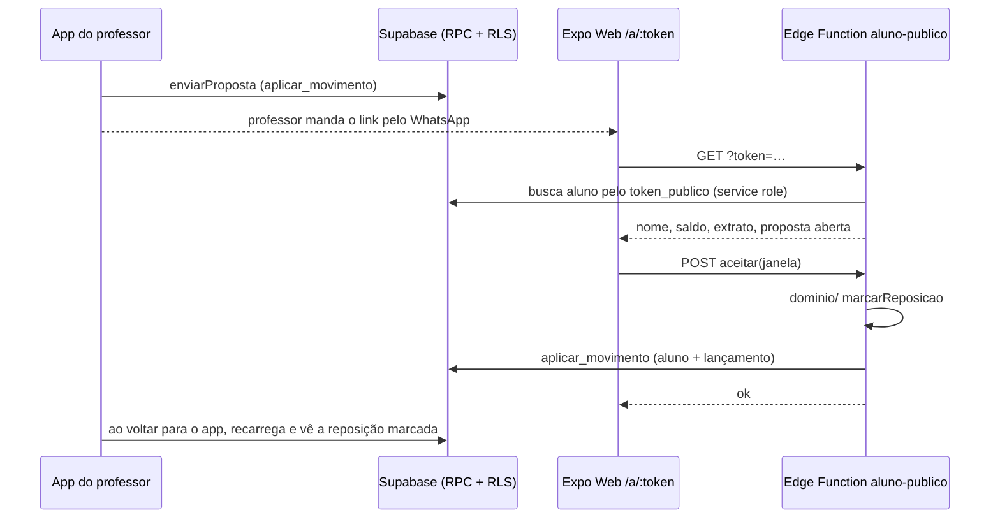

# Plano do backend: Aula em Dia

> **Situação:** planejamento aprovado em 24/09/2026. Nenhuma parte foi construída ainda.
> **Como usar:** cada parte vira uma entrega pequena, que funciona sozinha e tem um critério de "pronto".
> A ordem importa, porque cada parte usa o que a anterior deixou de pé. A Parte 0 é o material da apresentação.

| Parte | O que entrega | Depende de | Esforço estimado |
|---|---|---|---|
| [0](#parte-0-visão-e-decisões) | Visão, arquitetura e decisões justificadas | nada | pronto (este documento) |
| [1](#parte-1-camada-de-repositório-no-app) | O app fala com um "repositório", não mais direto com o AsyncStorage | nada | 1–2 dias |
| [2](#parte-2-projeto-supabase-esquema-e-rls) | Banco modelado, isolado por professor e com dados de demonstração | nada | 1 dia |
| [3](#parte-3-autenticação) | Login e cadastro de verdade | 1, 2 | 1 dia |
| [4](#parte-4-leitura-e-escrita-simples) | O app carrega e salva perfil, configurações e alunos no Supabase | 3 | 2 dias |
| [5](#parte-5-operações-transacionais-rpc) | Aula, reposição, pagamento e pacote gravados de forma atômica | 4 | 2 dias |
| [6](#parte-6-link-público-do-aluno) | O aluno abre um link e vê saldo, extrato e proposta de reposição | 5 | 2–3 dias |
| [7](#parte-7-mensagens-e-lembretes) | WhatsApp de verdade e lembretes automáticos | 4 (wa.me: nenhuma) | 1–2 dias |
| [8](#parte-8-qualidade-e-operação) | Testes de banco, CI, segredos, LGPD e custos | contínua | contínua |

As estimativas supõem uma pessoa trabalhando meio período. São ordem de grandeza, não compromisso.

---

## Parte 0: Visão e decisões

### O problema

Hoje o Aula em Dia funciona **só no aparelho**. O estado inteiro é um JSON no AsyncStorage (chave
`aulaemdia.app.v4`, em [mobile/src/dados/armazenamento.ts](../../mobile/src/dados/armazenamento.ts)),
e o login é simulado ([mobile/src/estado/sessao.ts](../../mobile/src/estado/sessao.ts)). Isso trava quatro
promessas do Envio 01:

1. **Link público do aluno**, com saldo, extrato e proposta de reposição. É o item do MVP que também
   faz a divulgação do produto, e ele só existe se os dados estiverem fora do celular do professor.
2. **Trocar de aparelho sem perder nada.** Hoje, perder o celular é perder a carteira de alunos.
3. **Backup.** O extrato é o registro do dinheiro que o aluno já pagou.
4. **Plano pago por número de alunos.** A monetização precisa de uma conta que o servidor reconheça.

### O que já existe e vai ser aproveitado

- **35 telas prontas** em React Native + Expo, com 303 testes.
- **Regras de negócio puras e testadas** em [mobile/src/dominio/](../../mobile/src/dominio/):
  - `politica.ts`: saldo, faltas e desfechos da aula;
  - `agenda.ts`: o motor de reposição, que é o diferencial do produto;
  - `pacote.ts`, `disponibilidade.ts`, `mensagens.ts`, `validacao.ts`.

  Nenhum desses módulos importa React Native, então rodam em qualquer ambiente TypeScript.
- Uma store única ([mobile/src/estado/dados.ts](../../mobile/src/estado/dados.ts)) com todas as
  ações do app. É a costura onde o backend entra.

### Arquitetura proposta



**Em uma frase:** o app continua calculando as regras com o `dominio/` que já está testado. O
Supabase guarda os dados, isola cada professor com Row Level Security e grava cada movimento numa
transação. O aluno entra por um link com token, sem conta.

### Decisões (registro curto, estilo ADR)

| # | Decisão | Escolha | Alternativas consideradas | Por quê |
|---|---|---|---|---|
| D1 | Linguagem | **TypeScript** no app e nas Edge Functions, **SQL** no banco | Java/Spring, Python/FastAPI, C#/.NET | O domínio já é TS e testado. Qualquer outra linguagem obriga a reescrever e testar tudo de novo, e duas versões da mesma regra acabam divergindo. |
| D2 | Plataforma | **Supabase** (Postgres + Auth + RLS + Edge Functions) | API própria (Node + Fastify + Prisma + Postgres); Firebase (Firestore) | Ver a tabela abaixo. É Postgres puro: se o projeto crescer, os dados vão para uma API própria sem conversão. |
| D3 | Onde mora a regra | **No app** (`dominio/`); o banco só persiste, via RPC transacional | Edge Functions como autoridade; regras reescritas em PL/pgSQL | Mantém uma fonte única e testada. O risco (cliente adulterado) é baixo porque cada professor só escreve nos próprios dados. A RLS e os `CHECK` do banco seguram o pior caso. |
| D4 | Sem internet | **Online com cache local**: o Supabase é a fonte da verdade e o AsyncStorage é cache de leitura | Offline-first com fila de mutações | Offline-first exige fila, reenvio e resolução de conflito; é a parte mais cara de um app. No MVP, abrir sem rede mostra os dados em cache e salvar pede conexão. |
| D5 | Acesso do aluno | **Link com token** (`/a/<token>`) aberto no **Expo Web**, lendo por uma **Edge Function** | Conta de aluno; página web separada | O Envio 01 diz que o aluno não paga e não instala nada. O Expo Web reaproveita as telas de `telas/aluno/`, e o token pode ser revogado. |
| D6 | Autenticação | **Supabase Auth, e-mail e senha** | Magic link, login social | A tela de acesso já pede e-mail e senha, e `validacao.ts` já exige no mínimo 6 caracteres, que é o mesmo padrão do Supabase. |
| D7 | Método de banco | **Migrações SQL versionadas** (`supabase/migrations/`) pela Supabase CLI; nada editado à mão no painel | Editar no painel | O esquema fica revisável no git, reproduzível com `supabase db reset` e defensável na banca. |
| D8 | Contrato de tipos | **Tipos gerados** do banco (`supabase gen types typescript`) | Tipos escritos à mão | Se uma coluna muda, o `typecheck` do app quebra na hora, em vez de quebrar em produção. |
| D9 | Método de construção | **Fatias verticais** (as Partes 1–8), cada uma atrás da variável `EXPO_PUBLIC_BACKEND` | Tudo de uma vez | O app nunca fica quebrado. O modo local continua existindo para demo e para os testes. |

**Supabase × API própria × Firebase**

| Critério | Supabase | API própria (Fastify + Prisma) | Firebase |
|---|---|---|---|
| Tempo até o primeiro login funcionando | horas | dias | horas |
| Banco relacional (extrato como livro-razão, somas do financeiro) | ✅ Postgres | ✅ Postgres | ❌ documentos, somas no cliente |
| Isolamento por professor | ✅ RLS no banco | código em cada rota | regras do Firestore |
| Reaproveitar o `dominio/` em TS | ✅ app + Edge Functions (Deno) | ✅ Node | ✅ Cloud Functions |
| Hospedagem e custo no MVP | plano free (pausa após 7 dias sem uso) | servidor para manter (Render/Railway) | plano free |
| Saída se crescer | Postgres padrão, `pg_dump` | já é própria | migração de NoSQL para SQL |

> **Se a banca perguntar se Supabase é backend de verdade:** o backend é o esquema, as políticas de
> acesso, as funções transacionais e a Edge Function, e tudo isso é código versionado no repositório
> (Partes 2, 5 e 6). O Supabase fornece a infraestrutura (Postgres, autenticação, hospedagem), do mesmo
> jeito que uma API própria usaria um Postgres gerenciado.

### Riscos assumidos

| Risco | Como está coberto | Onde se resolve de vez |
|---|---|---|
| App adulterado grava um saldo errado | RLS limita o estrago aos dados do próprio professor. `CHECK` no banco impede saldo negativo. O extrato só aceita inserção. | Parte 5 (checagens); mover o cálculo para uma Edge Function se virar multi-professor |
| Dois aparelhos editam o mesmo aluno | Coluna `versao` com trava otimista na RPC | Parte 5 |
| Sem rede, não dá para salvar | Mensagem clara no toast; leitura pelo cache | Offline-first, fora do MVP |
| Dados pessoais de alunos, às vezes menores (LGPD) | Mínimo necessário (nome, telefone, e-mail opcional). Exclusão em cascata. | Parte 8 |
| Datas sem ano no app (`dd/mm`, `ANO_DEMO`) | Adaptador na fronteira: o banco guarda `date`, o app continua vendo `dd/mm` | PROXIMOS-PASSOS §3 (datas reais) |

---

## Parte 1: Camada de repositório no app

**Objetivo:** a store para de falar direto com o AsyncStorage e passa a falar com um `Repositorio`.
Nada muda para quem usa o app. Esta parte não depende do Supabase e pode ser feita antes.

**Feita no `SCRUM-17`.** O texto abaixo descreve o que foi construído. Onde isso difere do plano
original, a diferença e a razão estão em [Decisões tomadas na Parte 1](#decisões-tomadas-na-parte-1).

### O que fazer

1. `mobile/src/dados/repositorio.ts` traz a interface:

   ```ts
   export interface Repositorio {
     carregar(): Promise<Gravado | null>;
     /** chamado depois de cada ação; o local grava tudo, o remoto grava só o que mudou */
     registrar(mudanca: Mudanca, estado: Persistido): Promise<void>;
     /** "zerar dados de demonstração": só faz sentido no modo local */
     apagar(): Promise<void>;
   }
   ```

   `Mudanca` é uma união com um caso por ação da store que grava, com o mesmo nome da ação
   (`{ tipo: 'registrarAula', aluno, lancamento, desfecho }`, `{ tipo: 'salvarPoliticas', politicas }`, …).
   São 22 casos, e o typecheck cobra a correspondência nos dois sentidos: ação nova sem caso, ou caso
   sem ação, não compila. O mapa completo está no [Apêndice A](#apêndice-a-ações-da-store--backend).
2. `mobile/src/dados/adaptador.ts` é o repositório local: o `gravar()` e o `carregar()` que moravam em
   `estado/dados.ts`, com o mesmo formato e a mesma chave (`aulaemdia.app.v4`).
3. `estado/dados.ts`: toda ação continua **síncrona e otimista**. Ela calcula com o `dominio/`, faz
   `set()` e devolve o resultado na hora (as telas dependem disso, por exemplo o `EfeitoRegistro`).
   Depois chama `repositorio.registrar(...)` uma vez, sem esperar. O que acontece quando dá erro está
   nas decisões abaixo.
4. A escolha da implementação sai de `EXPO_PUBLIC_BACKEND` (`local` ou `supabase`), com `local` como
   padrão. Um valor sem implementação cai no local. Os testes rodam sempre no local.
5. **Conversor de fronteira** (`mobile/src/dados/conversor.ts`), usado só pelo repositório remoto.
   **Feito na Parte 4** (`SCRUM-20`), quando houve banco para receber. Ele converte entre o formato do app e o
   do banco, para as telas não mudarem, e segue esta tabela:

   | No app hoje | No banco | Regra do conversor |
   |---|---|---|
   | `'30/10'` (dd/mm) | `date` `2026-10-30` | O ano é inferido por `lerDdMm` a partir de hoje (`SCRUM-55`) |
   | `validade: 'sem prazo'` | `validade = null` | `null` ↔ `'sem prazo'` |
   | reais inteiros (`80`) | centavos (`8000`) | × 100 / ÷ 100 |
   | `Lancamento` sem id nem tipo | `lancamentos.id uuid` + `tipo` | Ver a decisão 1, abaixo |
   | `pendencia: { origem, dias }` | `pendencia_origem date` | `dias` passa a ser calculado (`diasEntre(origem, hoje)`) |
   | `pagamento.vence` / `pagamento.venceu` / `dias` | `pagamento_vencimento date` | `dias` calculado |
   | `hoje: boolean` | não é gravado | Derivado do dia fixo e da data de hoje |
   | `agendada`, `proposta.janela` (rótulos como "Sexta, 29/08") | `jsonb` igual ao app | Viram `timestamptz` junto com as datas reais |
   | id `al…` gerado por `Date.now()` | `uuid` | Ver a decisão 2, abaixo |

### Decisões tomadas na Parte 1

**1. `id` e `tipo` do lançamento.** O `Lancamento` do app só tem `d`, `t`, `s`, `delta`, `saldo` e
`dinheiro?`; o banco exige `id` e `tipo`.

- **`tipo` sai da mudança, não do título.** Todo lançamento nasce de uma ação, e a `Mudanca` que o
  leva ao repositório diz qual. É por isso que o caso `registrarAula` carrega o `desfecho`:

  | Ação | `tipo` no banco |
  |---|---|
  | `registrarAula` com `realizada` | `aula` |
  | `registrarAula` com `avisada` | `falta_avisada` |
  | `registrarAula` com `sem_aviso` | `falta_sem_aviso` |
  | `registrarAula` com `cancelada_professor` | `cancelada_professor` |
  | `marcarReposicao`; `responderProposta` aceita ou confirmada | `reposicao` |
  | `receberPagamento`, `registrarPagamentoCom` | `pagamento` |
  | `estenderValidade` | `validade` |
  | `criarPacote`, `renovarPacote`, `criarPacoteCom` | `pacote` |
  | `enviarProposta` | `proposta` |

- **Lançamento que já existia antes do banco** (a semente, e o estado local importado no primeiro
  login, item 4 da Parte 4) não tem mudança de onde tirar o tipo. Para esses vale o título exato:
  "Aula realizada" → `aula`; "Falta avisada" → `falta_avisada`; "Falta sem aviso" → `falta_sem_aviso`;
  "Aula cancelada por você" → `cancelada_professor`; "Reposição marcada" e "Reposição realizada" →
  `reposicao`; "Pagamento recebido" → `pagamento`; "Validade estendida" → `validade`;
  "Pacote de N aulas" → `pacote`; "Proposta de reposição enviada" → `proposta`. O que não casar com
  nenhum vira `legado`, que é para isso que o valor existe no enum. É a mesma tabela que o gerador
  de `seed.sql` usa.
- **`id` não é sintetizado no app.** Quem gera é o banco (`default gen_random_uuid()`). O app nunca
  endereça um lançamento pelo id, porque o extrato só recebe inserção, e por isso `Lancamento` segue
  sem o campo e `dominio/tipos.ts` não muda. A ordem do extrato, que hoje é a posição no array, vira
  `criado_em desc`; na importação em lote o `criado_em` é montado a partir da posição, para dois
  lançamentos do mesmo dia não trocarem de lugar.

**2. O uuid do aluno entra na Parte 4, não aqui.** Antes de existir banco nada consome uuid, e trocar
agora não tiraria trabalho de depois: os ids da semente (`val`, `raf`, …) e os `al…` de quem já usa o
app também não são uuid, então a importação da Parte 4 precisa de um mapa de ids de qualquer jeito.
Fazer aqui só acrescentaria o `expo-crypto` a uma parte cujo papel é abrir a fronteira. Na Parte 4:
`criarAluno` passa a gerar o id com `randomUUID()`, e a importação troca os ids antigos uma única vez,
em `alunos` e nas chaves de `extratos`.

**3. Erro de persistência deixou de ser engolido, mas ainda não chega à tela.** O `gravar()` antigo
tinha um `catch` vazio. Agora o repositório rejeita a promessa e a store decide num lugar só
(`aoFalharNaPersistencia`, em `estado/dados.ts`). No modo local a decisão é manter a tela como está:
a memória é o que a pessoa vê, e recarregar de um disco que acabou de falhar jogaria fora o que ela
fez. O erro aparece no console em desenvolvimento. **Falta** o aviso na tela, porque o texto de
toast mora em `estado/avisos.ts`, que é da camada de apresentação. Com o repositório remoto é nesse
mesmo ponto que entram a recarga e o toast.

**4. Uma gravação por ação, e não duas.** Antes, um movimento gravava o estado duas vezes: uma com o
aluno alterado e outra com o lançamento. Agora a store avisa o repositório uma vez, depois de todos os
`set()`. O conteúdo final do disco é o mesmo; o que deixa de existir é o estado intermediário, com a
aula debitada e sem o lançamento.

**5. Nomes de arquivo.** O card deu o nome `adaptador.ts` ao repositório local, e é lá que o
AsyncStorage ficou. A conversão app ↔ banco, que este plano chamava de adaptador, passa a se chamar
**conversor de fronteira** para os dois não se confundirem.

### Pronto quando

- `npm test` e `npm run typecheck` passam.
- Nenhum arquivo fora de `mobile/src/dados/` importa AsyncStorage para dados (tema e sessão continuam como estão).
- Com `EXPO_PUBLIC_BACKEND=local`, o app se comporta exatamente como hoje.

### Como demonstrar

Mostrar o diagrama: as telas não sabem de onde vêm os dados, e trocar a fonte é trocar uma variável.

---

## Parte 2: Projeto Supabase, esquema e RLS

**Objetivo:** o banco existe, modelado a partir de [mobile/src/dominio/tipos.ts](../../mobile/src/dominio/tipos.ts),
com cada professor enxergando só os próprios dados.

### Preparação

```bash
# na raiz do repositório (precisa de Docker Desktop para o ambiente local)
npx supabase start                   # sobe Postgres, Auth e Studio locais
npx supabase db reset                # aplica as migrações + supabase/seed.sql
npx supabase test db                 # RLS com dois professores (pgTAP)
node scripts/gerar-seed-sql.mjs      # só quando data/seed.json ou a semente mudarem
npx supabase gen types typescript --local > mobile/src/dados/banco.ts   # só quando o esquema mudar
```

O `supabase init` já foi rodado: `supabase/config.toml` está versionado e fixa as portas e a
versão do Postgres para as três pessoas. O dia a dia está em
[supabase/README.md](../../supabase/README.md).

Para o projeto na nuvem: criar em supabase.com, depois rodar `npx supabase link --project-ref <ref>`
e `npx supabase db push`.

### Modelo de dados



**Escolhas de modelagem que vale explicar na banca:**

- **O extrato é um livro-razão.** Lançamento só é inserido, nunca editado nem apagado; correção vira
  outro lançamento. É o mesmo princípio de um extrato bancário.
- **`professor_id` repetido nas tabelas filhas.** A RLS vira uma comparação simples, sem join.
- **Configurações em `jsonb`** (blocos, folgas, pacote padrão, preferências). O app sempre as lê e
  grava inteiras e nunca consulta dentro delas.
- **`pendencia.dias` e `pagamento.dias` não são gravados.** Valor derivado de data não fica no
  banco, porque envelhece errado.

### Migração `0001_esquema.sql` (esboço)

```sql
create type faixa_de_alunos  as enum ('1–5', '6–15', '16+');
create type plano            as enum ('gratuito', 'pago');
create type status_pagamento as enum ('pago', 'aberto', 'atraso', 'sem');
create type status_proposta  as enum ('enviada', 'aceita', 'recusada', 'confirmadaPeloProfessor');
create type tipo_lancamento  as enum (
  'aula', 'falta_avisada', 'falta_sem_aviso', 'cancelada_professor',
  'reposicao', 'pagamento', 'pacote', 'validade', 'proposta', 'legado'
);

create table public.professores (
  id                 uuid primary key references auth.users on delete cascade,
  nome               text not null default '',
  iniciais           text not null default '',
  email              text not null,
  disciplinas        text[] not null default '{}',
  faixa_de_alunos    faixa_de_alunos,
  chave_pix          text,
  plano              plano not null default 'gratuito',
  pacote_padrao      jsonb,
  preferencias_aviso jsonb,
  criado_em          timestamptz not null default now()
);

create table public.politicas (
  professor_id      uuid primary key references public.professores on delete cascade,
  aviso_horas       int  not null default 24 check (aviso_horas >= 0),
  avisada_devolve   bool not null default true,
  limite_reposicoes int  not null default 3  check (limite_reposicoes >= 0),
  validade_dias     int  not null default 60 check (validade_dias >= 0)
);

create table public.disponibilidades (
  professor_id           uuid primary key references public.professores on delete cascade,
  blocos                 jsonb not null default '[]',
  aceita_fora_dos_blocos bool  not null default false,
  sugere_sabado          bool  not null default false,
  folgas                 jsonb not null default '[]'
);

create table public.alunos (
  id                      uuid primary key default gen_random_uuid(),
  professor_id            uuid not null default auth.uid() references public.professores on delete cascade,
  nome                    text not null,
  disciplina              text not null,
  dia                     text not null,
  hora                    text not null,
  telefone                text,
  email                   text,
  -- pacote
  total                   int  not null default 0 check (total >= 0),
  usadas                  int  not null default 0 check (usadas >= 0),
  validade                date,
  validade_estendida      bool not null default false,
  sem_pacote              bool not null default false,
  encerrado               date,
  valor_por_aula_centavos int  check (valor_por_aula_centavos >= 0),
  -- reposição
  reposicoes              int  not null default 0,
  pendencia_origem        date,
  agendada                jsonb,
  disponibilidade         jsonb,
  -- cobrança
  pausado                 bool not null default false,
  lembretes               int  not null default 0,
  ultimo_lembrete         date,
  atrasos_historicos      int  not null default 0,
  pagamento_status        status_pagamento not null default 'sem',
  pagamento_em            date,
  pagamento_meio          text,
  pagamento_vencimento    date,
  -- controle
  arquivado               bool not null default false,
  token_publico           uuid not null unique default gen_random_uuid(),
  versao                  int  not null default 0,
  criado_em               timestamptz not null default now(),
  constraint saldo_nao_negativo check (usadas <= total)
);

create table public.lancamentos (
  id            uuid primary key default gen_random_uuid(),
  aluno_id      uuid not null references public.alunos on delete cascade,
  professor_id  uuid not null references public.professores on delete cascade,
  tipo          tipo_lancamento not null,
  data          date not null,
  titulo        text not null,
  subtitulo     text not null default '',
  delta         int  not null,
  saldo_depois  int  not null check (saldo_depois >= 0),
  dinheiro      bool not null default false,
  criado_em     timestamptz not null default now()
);
create index lancamentos_do_aluno on public.lancamentos (aluno_id, criado_em desc);

create table public.propostas (
  id            uuid primary key default gen_random_uuid(),
  aluno_id      uuid not null references public.alunos on delete cascade,
  professor_id  uuid not null references public.professores on delete cascade,
  janela        jsonb not null,
  alternativas  jsonb not null default '[]',
  status        status_proposta not null default 'enviada',
  enviada_em    date not null,
  respondida_em timestamptz
);
-- no máximo uma proposta aberta por aluno, como no app
create unique index uma_proposta_aberta on public.propostas (aluno_id) where status = 'enviada';
```

> O `check (usadas <= total)` reflete o que o domínio já garante: `registrarAula` em `politica.ts`
> nunca deixa o saldo abaixo de zero. Se o banco recusar um movimento por isso, é bug no app.

### Migração `0002_rls.sql` (esboço)

```sql
alter table public.professores      enable row level security;
alter table public.politicas        enable row level security;
alter table public.disponibilidades enable row level security;
alter table public.alunos           enable row level security;
alter table public.lancamentos      enable row level security;
alter table public.propostas        enable row level security;

create policy "o próprio perfil" on public.professores
  for all using (id = (select auth.uid())) with check (id = (select auth.uid()));

-- mesmo padrão para politicas, disponibilidades, alunos e propostas
create policy "os próprios alunos" on public.alunos
  for all using (professor_id = (select auth.uid()))
  with check (professor_id = (select auth.uid()));

-- extrato: lê e insere, nunca edita nem apaga (sem policy de update/delete)
create policy "lê o próprio extrato" on public.lancamentos
  for select using (professor_id = (select auth.uid()));
create policy "insere no próprio extrato" on public.lancamentos
  for insert with check (
    professor_id = (select auth.uid())
    and exists (select 1 from public.alunos a
                where a.id = aluno_id and a.professor_id = (select auth.uid()))
  );
```

### Dados de demonstração

`supabase/seed.sql` é gerado a partir de [data/seed.json](../../data/seed.json) por um script
(`scripts/gerar-seed-sql.mjs`), com os 4 alunos e seus extratos sob um professor de teste (definido
logo abaixo). Não é escrito à mão: o seed.json continua sendo a fonte, como diz o CLAUDE.md.

**Feito no `SCRUM-18`.** O script da raiz só executa. A regra mora em
[mobile/src/dados/sementeSql.ts](../../mobile/src/dados/sementeSql.ts), que é TypeScript tipado
contra o domínio e contra `banco.ts`, e um teste do jest compara o `seed.sql` comitado com o que o
gerador produz: quem mudar a semente e não regerar quebra o CI.

### Decisões tomadas na Parte 2

**1. Título → `tipo_lancamento`.** O gerador consome a tabela da Parte 1 (decisão 1). Os sete
títulos da semente viram tipo; nenhum cai em `legado`, e há teste que cobra isso.

**2. As datas ficam relativas também no banco.** A pergunta era se o `seed.sql`, que é comitado,
seria regerado a cada `db reset` ou ficaria congelado no dia da geração. Nenhum dos dois: ele guarda
o deslocamento, e quem resolve é o Postgres, na hora do `db reset`.

| Na semente | No `seed.sql` |
|---|---|
| `"hoje-12"` numa coluna `date` | `pg_temp.hoje() - 12` |
| `"Pago em {hoje-58} · Pix"` | `'Pago em ' \|\| pg_temp.ddmm(-58) \|\| ' · Pix'` |
| `"{dia:hoje+1}"` dentro de um `jsonb` | `pg_temp.dia_e_data(1)`, que devolve "Sexta, 09/10" |
| `"07/09"` (feriado), dentro de um `jsonb` | fica `"07/09"`: o `jsonb` é igual ao app, sem ano |

Com isso o arquivo é comitado uma vez, não envelhece e sai igual em qualquer dia, que é o que deixa
o teste-guarda existir. As funções `pg_temp.*` são criadas no começo do seed e só vivem naquela
sessão. O "hoje" do banco é o de `America/Sao_Paulo`: o contêiner roda em UTC e viraria o dia às
21h. A gramática da notação continua num lugar só, `lerNotacao` em `dados/semente.ts`; o app troca
cada deslocamento por dd/mm e o gerador troca por SQL. Uma data absoluta numa coluna `date` faz o
gerador falhar, porque sem ano ela não é uma data; a semente não tem nenhuma.

**3. `validade` vazia, ausente e `'sem prazo'` viram `null`.** São três formas de dizer que não há
data. No app, `criarAluno` grava `''` e `bea` nem tem o campo, os dois com `semPacote`; `'sem prazo'`
é o pacote sem validade. No banco as três são `validade is null`, e na volta o conversor da Parte 4
distingue pelo `sem_pacote`: com ele, `''`; sem ele, `'sem prazo'`.

**4. Perfil e disponibilidade saem de `dados/semente.ts`, não do JSON.** O gerador importa
`PERFIL_PADRAO` e a disponibilidade ainda na notação, em vez de copiar os valores. Uma exceção:
`professores.email` recebe o e-mail do login (`professor@exemplo.test`), não o de demonstração que
o app monta a partir do nome. É o que o trigger da Parte 3 vai fazer com `new.email`.

**5. Os quatro alunos da semente têm uuid fixo.** O app ainda usa `val`, `raf`, `mar` e `bea`; o
banco exige uuid. A tabela está em `ID_DO_ALUNO` (`…-000000000101` a `…-000000000104`) e é o começo
do mapa de ids da Parte 4. O `token_publico` fica com o default do banco.

**6. A ordem do extrato vira `criado_em`.** No app o extrato é uma lista do mais novo para o mais
antigo. O seed grava `criado_em` como o meio-dia da data, menos a posição na lista em segundos, e o
gerador falha se a lista não estiver nessa ordem.

**7. O seed pode rodar mais de uma vez.** `professores`, `politicas` e `disponibilidades` usam
`on conflict … do update`, que é também o que faz o perfil ser gravado quando o trigger da Parte 3
já tiver criado as três linhas. Os alunos são apagados e inseridos de novo, porque o extrato não
tem chave natural; o `delete` cascateia lançamentos e propostas. O bloco do professor de teste entra
sem `begin`/`commit`: o CLI já aplica o seed do seu jeito, e fora dele o arquivo roda igual.

**8. O que não vai para o banco.** `hoje`, `pendencia.dias` e `pagamento.dias` são derivados.
`janelasReposicao` e `janelaValidadeEstendida` são as janelas fixas do handoff, que o app já trocou
pelo motor `agenda.ts`, e não têm tabela.

**9. O segundo professor existe só no teste.** `supabase/tests/database/rls.test.sql` cria o
professor B dentro de uma transação e desfaz no fim. O `seed.sql` continua com um professor, fiel ao
`seed.json`.

**Onde foi testado.** Em 08/10/2026, com PostgreSQL 17.11, Supabase CLI 2.120.0 e pgTAP pelo
`supabase test db`, só no ambiente local: `db reset` duas vezes, o seed reaplicado duas vezes por
cima (4 alunos, 13 lançamentos e 1 proposta nas quatro), os 30 casos de RLS, o login pela API e o
seed com o trigger da Parte 3 instalado só no banco local. O que o banco gravou foi comparado,
campo a campo, com o que o app resolve no mesmo dia: nenhuma diferença.

### Professor de teste do seed

Decidido no `SCRUM-50`. **Somente banco local, nunca produção.**

```
uuid  00000000-0000-4000-8000-000000000001
email professor@exemplo.test
senha aulaemdia-local
```

O uuid é um v4 válido e fácil de reconhecer numa consulta, o domínio `.test` é reservado e nunca
entrega e-mail, e a senha não é usada em nenhum outro lugar. Nenhuma chave do projeto entra no seed:
ele só precisa destes três valores.

**Por que existe.** O seed roda sem contexto de autenticação, então `auth.uid()` devolve `null`.
Como `alunos.professor_id` é `not null default auth.uid()`, inserir um aluno sem informar o
professor falha (`null value in column "professor_id" ... violates not-null constraint`). Informar o
professor exige uma linha em `professores`, que por sua vez exige uma linha em `auth.users`, e o
trigger que cria `professores` a partir de `auth.users` só chega na Parte 3. Por isso o seed insere
as duas explicitamente, com uuid fixo, sem depender do default nem do trigger.

**O SQL testado.** É o primeiro bloco do `seed.sql`, antes de qualquer aluno:

```sql
-- Professor de teste do Aula em Dia. SOMENTE banco local, nunca produção.
begin;

insert into auth.users (
  instance_id, id, aud, role, email, encrypted_password,
  email_confirmed_at, raw_app_meta_data, raw_user_meta_data,
  created_at, updated_at,
  confirmation_token, email_change, email_change_token_new, recovery_token
) values (
  '00000000-0000-0000-0000-000000000000',
  '00000000-0000-4000-8000-000000000001',
  'authenticated', 'authenticated',
  'professor@exemplo.test',
  extensions.crypt('aulaemdia-local', extensions.gen_salt('bf')),
  now(),
  '{"provider":"email","providers":["email"]}', '{}',
  now(), now(),
  '', '', '', ''
)
on conflict (id) do nothing;

insert into auth.identities (
  id, user_id, provider_id, provider, identity_data,
  last_sign_in_at, created_at, updated_at
) values (
  '00000000-0000-4000-8000-000000000001',
  '00000000-0000-4000-8000-000000000001',
  '00000000-0000-4000-8000-000000000001',
  'email',
  jsonb_build_object(
    'sub',   '00000000-0000-4000-8000-000000000001',
    'email', 'professor@exemplo.test',
    'email_verified', true
  ),
  now(), now(), now()
)
on conflict (provider_id, provider) do nothing;

insert into public.professores (id, email)
values ('00000000-0000-4000-8000-000000000001', 'professor@exemplo.test')
on conflict (id) do nothing;

commit;
```

O que cada detalhe segura, conferido no banco e não presumido:

- **Os quatro tokens como `''`.** Com eles em `null`, o login devolve 500 (`Database error querying
  schema`), porque o serviço de Auth não converte `null` em texto ao ler `confirmation_token`.
- **`extensions.crypt`.** O `pgcrypto` mora no schema `extensions`; sem o prefixo a função não é
  encontrada.
- **`auth.identities`.** Nesta versão o login por senha funciona mesmo sem a linha, mas ela fica: é
  o que o `signUp` cria, e o usuário de teste deve ter a mesma forma de um usuário real. O `id` é o
  uuid fixo, e o `on conflict` aponta para `(provider_id, provider)`, que é o índice único da
  tabela. As colunas `email` de `auth.identities` e `confirmed_at` de `auth.users` são geradas e não
  entram no insert.
- **`professores (id, email)`.** `email` é a única coluna `not null` sem default. Nome, iniciais e
  disciplinas vêm do gerador, na `SCRUM-18`.

**Onde foi testado.** Em 07/10/2026, com PostgreSQL 17.11, Supabase CLI 2.120.0 e Auth (GoTrue)
v2.197.0, só no ambiente local. A forma de `auth.users` e `auth.identities` muda entre versões:
ao subir a versão do CLI, rodar este roteiro de novo.

1. `npx supabase db reset`, depois o bloco duas vezes seguidas pelo `psql`, como `postgres` e com
   `ON_ERROR_STOP=1`. A primeira insere uma linha em cada tabela; a segunda não insere nenhuma e
   também sai sem erro.
2. Um aluno mínimo (`professor_id`, `nome`, `disciplina`, `dia`, `hora`) entra com este
   `professor_id`, dentro de uma transação desfeita em seguida.
3. `POST /auth/v1/token?grant_type=password` com o e-mail e a senha devolve `access_token`. Com esse
   token, `select` em `professores` devolve só a linha do professor de teste; sem ele, devolve vazio.

**Interação com a Parte 3.** Quando a `0003_novo_professor.sql` existir, o insert em `auth.users`
dispara o trigger, que cria sozinho as linhas de `professores`, `politicas` e `disponibilidades`.
Fica valendo a **idempotência**: o insert explícito em `professores` usa `on conflict (id) do
nothing` e o bloco roda igual com ou sem o trigger. Foi testado com o trigger deste plano instalado
só no banco local: as duas execuções passam e sobra uma linha em cada tabela. Sem o `on conflict`, a
mesma execução para em `duplicate key value violates unique constraint "professores_pkey"`.

A alternativa era o seed rodar antes de o trigger existir. Foi recusada porque o `db reset` aplica
todas as migrações e só depois o seed: assim que a `0003` entrar, o seed sempre encontra o trigger.
Depender da ordem faria o seed quebrar no primeiro `db reset` da Parte 3.

Duas consequências para quem escrever o resto do seed:

- `do nothing` não sobrescreve. Com o trigger no lugar, a linha de `professores` já chega criada
  só com `id` e `email`; o perfil (nome, iniciais, disciplinas, faixa) tem de entrar por `on
  conflict (id) do update` ou por um `update` depois do bloco.
- O mesmo vale para `politicas` e `disponibilidades`: o trigger as cria com os padrões, então os
  inserts do seed precisam de `on conflict (professor_id) do update`.

O `seed.sql` foi gerado na `SCRUM-18` com este bloco. Duas diferenças, as duas previstas acima: ele
entra sem o `begin`/`commit`, e o insert em `professores` leva o perfil com `on conflict (id) do
update`.

### Pronto quando

- `npx supabase db reset` sobe tudo sem erro.
- `npx supabase test db` passa: o professor A não enxerga nem altera nada do professor B, e o
  contrário.
- No Studio, logado como o professor A, não aparece nenhum aluno do professor B. O roteiro, com o
  SQL que cria o B, está em [supabase/README.md](../../supabase/README.md).
- `mobile/src/dados/banco.ts` foi gerado e compila.

### Como demonstrar

Abrir o Studio e mostrar as tabelas. No SQL Editor, rodar `select * from alunos` como dois usuários
diferentes e mostrar resultados diferentes: é a RLS funcionando.

---

## Parte 3: Autenticação

**Objetivo:** criar conta e entrar de verdade. As fases da entrada (`carregando → entrada → onboarding → app`)
continuam as mesmas.

**Feita no `SCRUM-19`**, com o banco local (`npx supabase start`): o projeto na nuvem não é
pré-requisito. O texto abaixo descreve o que foi construído; as escolhas e as razões estão em
[Decisões tomadas na Parte 3](#decisões-tomadas-na-parte-3). Google e recuperação de senha ficaram
fora por decisão de PO (14/10): os dois precisam de deep link, que no Expo Go é frágil, e viraram o
`SCRUM-62` e o `SCRUM-63`.

### O que fazer

1. `@supabase/supabase-js` e `react-native-url-polyfill` nas dependências, e
   `mobile/src/dados/supabase.ts` com o cliente, **criado só na primeira chamada** de
   `clienteSupabase()`:

   ```ts
   const novo = createClient<Database>(url, chave, {
     auth: { storage: AsyncStorage, autoRefreshToken: true, persistSession: true, detectSessionInUrl: false },
   });
   ```

   A URL e a chave vêm de `EXPO_PUBLIC_SUPABASE_URL` e `EXPO_PUBLIC_SUPABASE_PUBLISHABLE_KEY`.
   `usaSupabase()` lê `EXPO_PUBLIC_BACKEND`, no mesmo padrão de `dados/repositorio.ts`.
2. `estado/sessao.ts`, no modo `supabase`:
   - "Entrar" chama `signInWithPassword`; "Criar conta" chama `signUp` e abre o onboarding.
   - `entrar(email, senha?)` e `criarConta(email, senha?)` devolvem `Promise<string | null>`:
     `null` deu certo; senão, a frase de `ERRO` para a tela mostrar.
   - "Sair" chama `signOut`.
   - `carregar` pergunta ao `getSession`, e não à chave `CHAVE_SESSAO`.
   - `loginReal()` diz à tela se o login é de verdade, sem ela ler o ambiente.
   - No modo `local`, tudo como antes.
3. Migração `0003_novo_professor.sql`: um trigger em `auth.users` cria as linhas de `professores`,
   `politicas` e `disponibilidades` com os padrões:

   ```sql
   create function public.criar_professor() returns trigger
   language plpgsql security definer set search_path = '' as $$
   begin
     insert into public.professores (id, email) values (new.id, coalesce(new.email, ''));
     insert into public.politicas (professor_id) values (new.id);
     insert into public.disponibilidades (professor_id) values (new.id);
     return new;
   end $$;

   create trigger ao_criar_usuario after insert on auth.users
     for each row execute function public.criar_professor();
   ```
4. Confirmação de e-mail: desligada no MVP (no local, `enable_confirmations = false` em
   `supabase/config.toml`) para o cadastro seguir direto para o onboarding. Religar antes de
   publicar.

### Decisões tomadas na Parte 3

**1. O nome da chave é `EXPO_PUBLIC_SUPABASE_PUBLISHABLE_KEY`.** O plano já usava esse nome e o
`.env.example` dizia `…_ANON_KEY`. Ficou o do plano, que é o nome atual do Supabase para a chave
pública (o guia "Supabase + Expo" usa o mesmo) e o que o `npx supabase status` chama de
`PUBLISHABLE_KEY`.

**2. O polyfill de URL continua.** O guia oficial "Supabase + Expo" e o exemplo de React Native com
AsyncStorage da referência do `createClient` ainda instalam o `react-native-url-polyfill` e o
importam antes do cliente. Ele é carregado dentro de `clienteSupabase()`, para o modo local não ter
o `URL` global trocado.

**3. O cliente é preguiçoso.** Com `local` e nos testes, as variáveis vêm vazias: importar
`dados/supabase.ts` não lança nem abre conexão. Pedir o cliente sem as variáveis falha com a lista
do que falta, e a sessão transforma isso na falha genérica, com o motivo no console em
desenvolvimento. A renovação do token só roda com o app em primeiro plano, por um ouvinte de
`AppState`, como recomenda a referência do `startAutoRefresh`.

**4. Erro do Supabase vira frase pelo código, nunca pelo texto em inglês.** A documentação de
códigos de erro do Supabase Auth manda usar `error.code` e `error.name`. Cada caso foi conferido
contra o Auth local (CLI 2.120, GoTrue 2.197):

| O que aconteceu | O que o Supabase devolve | Frase (`ERRO`) |
|---|---|---|
| e-mail ou senha errados | `invalid_credentials` (400) | `credenciaisInvalidas` |
| cadastro com e-mail que já existe | `user_already_exists` (422); a doc também lista `email_exists` | `emailJaCadastrado` |
| senha curta no cadastro | `weak_password` (422) | `senhaCurta` |
| sem rede | `AuthRetryableFetchError`, status 0 | `semConexao` |
| qualquer outro (limite de tentativas, servidor fora do ar, e-mail não confirmado) | — | `falhaNoAcesso` |

`weak_password` vira `senhaCurta` porque a única exigência configurada é o tamanho mínimo, o mesmo
`SENHA_MINIMA` do app. Para e-mail e senha que a tela já sabe recusar, a sessão usa `validarAcesso`
e nem vai à rede: sem senha, por exemplo, devolve `senhaVazia`.

**5. No modo `supabase`, quem lembra do login é o supabase-js.** `CHAVE_SESSAO` não é lida nem
gravada: o token fica no AsyncStorage, na chave do próprio supabase-js (`sb-…-auth-token`). A senha
nunca chega ao disco; isso foi conferido olhando o AsyncStorage depois de um cadastro de verdade.

**6. "Sair" funciona sem rede.** A tela volta para a entrada na hora, e o `signOut` do
supabase-js 2.118 apaga a sessão do aparelho mesmo quando a chamada ao servidor falha (lido no
código do `auth-js`): reabrir o app não volta logado.

**7. Cadastro sem sessão não abre o onboarding.** Se a confirmação de e-mail estiver ligada, o
`signUp` cria o usuário sem sessão. Seguir para o onboarding deixaria a pessoa num app que não grava
nada no banco; a sessão devolve `falhaNoAcesso`. Com a confirmação desligada, que é o combinado do
MVP, isso não acontece.

**8. A assinatura nova não obriga a tela a mudar.** A senha é opcional e a promessa pode ser
ignorada: `Acesso.tsx` e `Conta.tsx` seguem compilando como estão. É o `SCRUM-59` que passa a
mandar a senha e mostrar a frase. Até lá, no modo `supabase` o "Entrar" da tela, que não manda
senha, recebe `senhaVazia` e não faz nada.

**9. O trigger.** `security definer` porque quem insere em `auth.users` é o serviço de Auth, sem
permissão em `public`. `coalesce` no e-mail porque `professores.email` é `not null` e um usuário
criado sem e-mail derrubaria o cadastro. O `seed.sql` convive com ele pela decisão 7 da Parte 2:
o trigger cria as três linhas e o seed grava o perfil por cima.

**O que fica em aberto.**

- No modo `supabase`, quem fecha o app no meio do onboarding volta direto para o app, porque a
  sessão existe e o onboarding não deixa marca no banco. A Parte 4 pode guardar "onboarding
  concluído" no professor. **Respondido na Parte 4, decisão 9:** guarda, na `0004`.
- Os dados continuam no aparelho mesmo no modo `supabase`: o repositório remoto é a Parte 4, e
  até lá `escolherRepositorio` cai no local com um aviso.

**Onde foi testado.** Em 15/10/2026, contra o banco local: `db reset` com a `0003`, os testes pgTAP
(o do trigger e o de RLS), e a sessão de verdade num teste temporário contra o Auth local —
senha errada, e-mail repetido, senha curta, cadastro, reabrir logado, sair e entrar. No
`sessao.test.ts`, que roda no CI, o cliente é simulado com os erros nessa mesma forma.

### Pronto quando

- Criar conta faz a linha aparecer em `professores` no painel.
- Fechar e abrir o app mantém a pessoa logada.
- "Sair" volta para a tela de acesso.
- Com `local`, tudo como antes, sem `.env`.

---

## Parte 4: Leitura e escrita simples

**Objetivo:** com `EXPO_PUBLIC_BACKEND=supabase`, o app carrega tudo do banco e grava as ações que
não mexem em saldo.

### O que fazer

1. `RepositorioSupabase.carregar()`: seis `select` em paralelo (professor, políticas,
   disponibilidade, alunos, lançamentos, propostas abertas). O conversor de fronteira monta o mesmo
   `Persistido` que a store já espera. O resultado também vai para o AsyncStorage como cache, e na
   próxima abertura o app mostra o cache primeiro e atualiza em seguida.
2. Ações de gravação direta (sem lançamento no extrato):

   | Ação da store | Operação |
   |---|---|
   | `salvarPerfil`, `salvarPacotePadrao`, `salvarPreferenciasDeAviso` | `update professores` |
   | `salvarPoliticas` | `update politicas` |
   | `salvarDisponibilidade` | `update disponibilidades` |
   | `criarAluno` | `insert alunos` (id gerado no app) |
   | `atualizarAluno`, `arquivarAluno`, `alternarPausa`, `salvarDisponibilidadeDoAluno` | `update alunos` |
   | `enviarLembrete`, `cobrarTodosEmAtraso` | `update alunos` (um ou vários) |

3. O onboarding (`telas/entrada/Perfil.tsx`, `PoliticaInicial.tsx`, `Disponibilidade.tsx`,
   `PrimeiroAluno.tsx`) passa a gravar no banco pelo mesmo caminho, sem mudança nas telas.
4. **Importar os dados locais.** No primeiro login de um aparelho que já tem dados no AsyncStorage
   (`aulaemdia.app.v4`), perguntar "Levar seus alunos para a conta?" e enviar tudo. Os lançamentos
   antigos entram com `tipo = 'legado'`.
5. Falha de rede: o toast existente mostra "Não deu para salvar. Confira a conexão e tente de novo." e
   a store recarrega do banco.

### Decisões tomadas na Parte 4

**Feita no `SCRUM-20`.** O que foi construído: `mobile/src/dados/conversor.ts` (app ↔ banco, puro),
`repositorioSupabase.ts` (`carregar` e `registrar`), `importacao.ts` (`importarDadosLocais`) e a
migração `0004_onboarding.sql`. `escolherRepositorio('supabase')` devolve o repositório do banco, e
`local` continua o padrão. Nenhuma tela mudou.

**1. As ações que mexem em saldo rejeitam até a Parte 5.** (Superada no `SCRUM-21`: hoje elas
gravam pela RPC; ver as Decisões da Parte 5.) Aula, falta, reposição, pagamento,
pacote, validade e proposta gravam aluno e lançamento juntos, e isso é a RPC. Até lá o repositório
rejeita com `AindaNaoGravaNoBanco`, e a store trata como qualquer falha (decisão 3): a tela volta
ao que o banco tem. Gravar só o aluno deixaria saldo sem extrato; ignorar em silêncio faria a ação
sumir na próxima carga sem ninguém saber. `atualizarAluno` que mexa em `total` ou `usadas` cai na
mesma regra.

**2. O `update` grava só as colunas que a ação mudou, e um `update` sem linha é erro.** A tabela
`CAMPOS_DA_ACAO` diz o que cada ação muda (`alternarPausa` → `pausado`, `enviarLembrete` →
`lembretes` e `ultimo_lembrete`, …). Gravar a linha inteira levaria junto o saldo que está só na
memória. Para `atualizarAluno` não havia como saber, e a interface da Parte 1 estava incompleta: a
`Mudanca` passou a levar `campos`, as chaves do patch. Com RLS, um `update` que não alcança linha
nenhuma volta sem erro; por isso todo `update` pede a linha de volta (`select`) e, sem ela, rejeita.

**3. Falha de gravação: o toast e a recarga do banco.** No remoto, `aoFalharNaPersistencia` mostra
`avisos.falhaAoSalvar` (do `SCRUM-61`) e recarrega, uma vez só por rajada de falhas. No local nada
muda. Falha de *carga* é outra coisa: só o console, porque a frase "não deu para salvar" não serve
para ela, e recarregar seria ler de novo o que acabou de falhar.

**4. Online com cache, sem fila (D4).** O cache é `aulaemdia.cache.v1`, com o id do professor
junto. A store mostra o cache primeiro (`lerCache`) e atualiza quando o banco responder. O cache é
regravado a cada carga e a cada gravação aceita. Sem rede, `carregar` devolve o cache, e o de outra
conta não serve. `carregar` espera as gravações que estão no ar: no fim do onboarding o app abre e
lê o banco logo depois do último passo, e a leitura não pode chegar antes do aluno recém-criado.
Alunos e extrato vêm em páginas de 1000, que é o `max_rows` da API: ela corta sem avisar.

**5. O ponto de partida do modo supabase é a conta vazia, não a semente.** `estadoVazio()` tem os
padrões das colunas (política 24h/devolve/3/60, perfil e disponibilidade vazios). O professor de
verdade não pode ver os alunos de demonstração como se fossem dele, nem gravá-los. "Sair" esvazia
a memória e apaga o cache (`useDados.esquecer`): quem entrar depois no aparelho não vê a conta
anterior.

**6. O que volta do banco diferente do que foi.** A ida e volta (`conversor.test.ts`) cobra o
resto como idêntico, e uma segunda volta igual à primeira. As diferenças são estas, todas iguais
para a tela:

| No app | Volta do banco como |
|---|---|
| `hoje: true` escrito à mão na semente | derivado do dia fixo: tem aula quando uma palavra de `dia` é o dia de hoje ("terça e quinta", "ter e qui") |
| `pausado: false`, `lembretes: 0`, `pendencia: null` e afins | ausentes, como a semente escreve |
| `validade` ausente com `semPacote` | `''`, como `criarAluno` grava (Parte 2, decisão 3) |
| `criadoEm` | o dia em que a linha nasceu no banco (no `criarAluno`, é o mesmo) |
| `perfil.email` | o e-mail do login; o `update` não grava e-mail, que é assunto do Supabase Auth |
| proposta respondida | ausente: só a aberta (`status = 'enviada'`) volta para dentro do aluno |

`pendencia.dias` e `pagamento.dias` são contados até hoje a partir da data com ano, sem inferir.

**7. O id do aluno novo é do repositório.** `Repositorio.novoIdDeAluno()`: o local segue com
`al…`, e o do Supabase usa `randomUUID()` do `expo-crypto`, que é o que a coluna `uuid` aceita.

**8. A importação leva os alunos, e nada sai do aparelho.** `importarDadosLocais()` lê
`aulaemdia.app.v4` e leva os alunos com o extrato e a proposta. Perfil, política e disponibilidade
ficam: a conta já tem os seus, do onboarding.

- **Os alunos da semente não vão.** São demonstração.
- **Cada aluno ganha um uuid novo, não os fixos de `ID_DO_ALUNO`.** Esses são do professor de
  teste, e duas contas importando o mesmo aluno colidiriam na chave primária.
- **O lançamento antigo leva o tipo pelo título, e o que não casar vira `legado`.** O card dizia
  `legado` para todos. Vale a decisão 1 da Parte 1, que é mais nova e guarda mais informação.
- **O ano de cada data do extrato sai do lançamento de cima.** Inferido a partir de hoje, um
  histórico de oito meses cairia no ano que vem.
- **Sem transação entre chamadas, o desfazer é à mão.** Se o extrato falha, os alunos que entraram
  são apagados (o `on delete cascade` leva o resto), e tentar de novo não duplica ninguém.
- **A marca `aulaemdia.importacao.v1` impede de importar duas vezes, inclusive para outra conta.**
  A pergunta "Levar seus alunos para a conta?" é do `SCRUM-61`. `temDadosLocaisParaImportar()`
  diz se ela deve aparecer. Quem chama recarrega a store depois.
- **"Agora não" grava a mesma marca, com o valor `dispensada`** (`dispensarImportacao()`,
  `SCRUM-68`). A pergunta não volta na próxima abertura, e a dispensa vale também para outra conta
  que entre depois no aparelho, como a importação. Os alunos locais são do aparelho, não de uma
  conta: perguntar de novo a cada login seria insistir com quem já respondeu. A função não rejeita
  (a tela chama sem esperar) e não sobrescreve a marca de uma importação feita. Como
  `importarDadosLocais()` não consulta a marca, levar os alunos depois, por outro caminho, continua
  possível.

**9. "Onboarding concluído" fica no banco, e responde o que estava em aberto na Parte 3.** A
`0004` cria `professores.onboarding_concluido` (padrão `false`; quem já existia vira `true`). A
sessão consulta a marca ao restaurar e ao entrar, e manda de volta ao passo 1 quem não terminou,
inclusive quem criou a conta noutro aparelho. O último passo grava `true`. Sem rede para saber,
vale o app, que abre pelo cache. O professor de teste do seed nasce com `true`. A alternativa,
deduzir do perfil vazio, confundiria quem parou no passo 2 com quem terminou.

**10. `plano` continua sendo gravado pelo app.** A tela Conta tem o "assinar" de demonstração, que
salva `plano: 'pago'`, e o `update` leva o valor. Quando houver cobrança de verdade, `plano` sai do
`update` e o banco passa a protegê-lo (privilégio de coluna ou trigger); até lá, quem quiser se dá
o plano pago pela API.

**Onde foi testado.** Em 23/10/2026, com Supabase CLI 2.120.0 e PostgreSQL 17.11:

- as suítes do conversor, do repositório (contra um Supabase simulado em memória), da importação,
  da store e da sessão;
- os 46 casos pgTAP, com os dois novos da `0004`;
- a ponta a ponta no Expo Web contra o banco local, com duas abas e 20 conferências:
  - a política editada numa aba aparece na outra, e o aluno criado, pausado e editado também;
  - registrar aula mostra o aviso e a tela volta ao saldo do banco;
  - sem rede, o app abre pelo cache e salvar avisa;
  - a conta nova abre sem nenhum aluno de demonstração;
  - fechar no meio do onboarding volta ao passo 1;
  - sair e entrar com outra conta não mostra a anterior;
- a importação contra o banco de verdade: o tipo pelo título, `legado` no que não casa, a proposta
  de volta dentro do aluno, e a RLS recusando com `42501` o insert para outro professor.

**O que fica em aberto.**

- A pergunta de importar, na tela: o segundo commit do `SCRUM-61`.
- ~~Carga que falha sem cache abre a conta vazia sem aviso.~~ **Resolvido no `SCRUM-72`:** no modo
  supabase, a carga que falha sem nada no cache mostra `avisos.cargaSemCache` ("Não deu para carregar
  seus alunos. Confira a conexão e abra o app de novo."), uma vez, sem tentar de novo sozinha (D4).
  Com cache o app abriu, e segue calado. No modo local, nada muda. Cache ilegível conta como sem
  cache.
- Uma gravação feita enquanto uma carga está no ar pode ser coberta na tela pela resposta da carga.
  O banco fica certo, e a próxima carga mostra.
- Abrir sem rede depois de o token vencer (1 hora) não foi testado: depende de o supabase-js
  manter a sessão quando a renovação falha.

### Pronto quando

- Editar a política num aparelho e abrir o app em outro (ou no Expo Web) mostra a mudança.
- Com o avião ligado, o app abre pelo cache e salvar mostra o aviso.

---

## Parte 5: Operações transacionais (RPC)

**Objetivo:** tudo que mexe no saldo ou no extrato grava **aluno + lançamento juntos**, ou nada. O
supabase-js não abre transação pelo cliente, então a transação mora numa função SQL.

### A função

**Feita no `SCRUM-21`.** O que roda é
[`supabase/migrations/0005_aplicar_movimento.sql`](../../supabase/migrations/0005_aplicar_movimento.sql).
O esboço abaixo ficou como estava antes. A `0005` difere dele em três pontos, explicados nas
[decisões](#decisões-tomadas-na-parte-5):

- tem o ramo da proposta escrito, no lugar do stub;
- grava também `encerrado`;
- só deixa chamar quem tem login.

```sql
create function public.aplicar_movimento(
  p_aluno      jsonb,             -- o aluno inteiro, já calculado pelo dominio/ e convertido pelo conversor
  p_versao     int,               -- a versão que o app leu
  p_lancamento jsonb default null,
  p_proposta   jsonb default null
) returns int                     -- a nova versão
language plpgsql
security invoker                  -- a RLS continua valendo dentro da função
set search_path = '' as $$
declare
  v_id   uuid := (p_aluno->>'id')::uuid;
  v_nova int;
begin
  update public.alunos a set
    total = n.total, usadas = n.usadas, validade = n.validade,
    validade_estendida = n.validade_estendida, sem_pacote = n.sem_pacote,
    reposicoes = n.reposicoes, pendencia_origem = n.pendencia_origem, agendada = n.agendada,
    pausado = n.pausado, pagamento_status = n.pagamento_status, pagamento_em = n.pagamento_em,
    pagamento_meio = n.pagamento_meio, pagamento_vencimento = n.pagamento_vencimento,
    valor_por_aula_centavos = n.valor_por_aula_centavos,
    versao = a.versao + 1
  from jsonb_populate_record(null::public.alunos, p_aluno) n
  where a.id = v_id and a.versao = p_versao
  returning a.versao into v_nova;

  if v_nova is null then
    raise exception 'conflito_de_versao'
      using hint = 'Este aluno mudou em outro aparelho. Recarregue.';
  end if;

  if p_lancamento is not null then
    insert into public.lancamentos
      (aluno_id, professor_id, tipo, data, titulo, subtitulo, delta, saldo_depois, dinheiro)
    select v_id, a.professor_id, l.tipo, l.data, l.titulo, l.subtitulo, l.delta, l.saldo_depois, l.dinheiro
    from jsonb_populate_record(null::public.lancamentos, p_lancamento) l, public.alunos a
    where a.id = v_id;
  end if;

  if p_proposta is not null then
    -- fecha a proposta aberta, se houver, e grava a nova (ou só a resposta)
    -- detalhado na implementação
    null;
  end if;

  return v_nova;
end $$;
```

**Por que a coluna `versao`:** se o professor registra a aula no celular e, ao mesmo tempo, o aluno
aceita a reposição pelo link, a segunda gravação encontra a versão mudada e falha em vez de
sobrescrever. O app recarrega e a pessoa refaz com os dados certos. Isso é a **trava otimista**. O
repositório guarda a versão de cada aluno num mapa interno, então o `dominio/` não precisa saber dela.

### Ações que passam pela RPC

`registrarAula`, `marcarReposicao`, `receberPagamento`, `registrarPagamentoCom`, `estenderValidade`,
`criarPacote`, `renovarPacote`, `criarPacoteCom`, `enviarProposta` e `responderProposta` (do lado do
professor). Em todas, o cálculo continua em `politica.ts` ou `pacote.ts` e a RPC só grava.

### Regra do plano gratuito (opcional nesta parte)

O Envio 01 limita o plano gratuito por número de alunos. Um trigger `before insert on alunos` recusa
o aluno N+1 quando `plano = 'gratuito'`. O **limite ainda precisa ser decidido** com o time.

### Decisões tomadas na Parte 5

O que foi construído:

- a migração `0005_aplicar_movimento.sql` e o teste `supabase/tests/database/aplicar_movimento.test.sql`;
- no app, as dez ações que mexem em saldo passam a chamar a RPC, em `mobile/src/dados/repositorioSupabase.ts`;
- a frase do conflito em `estado/dados.ts`, que é do commit de abertura do Rafael.

Nenhuma tela mudou, e o modo local também não.

**1. A RPC grava só as colunas de um movimento.** São estas:

- o pacote: `total`, `usadas`, `validade`, `validade_estendida`, `sem_pacote`, `encerrado` e `valor_por_aula_centavos`;
- a reposição: `reposicoes`, `pendencia_origem` e `agendada`;
- o pagamento: `pausado` e as quatro colunas de `pagamento_*`.

O app manda o aluno inteiro, mas o cadastro, o arquivo, os lembretes e a disponibilidade ficam de
fora. São gravados direto pela Parte 4, e um movimento com a memória deste aparelho não pode
desfazer o que outro aparelho editou neles.

- **`pausado` entra porque receber o pagamento tira a pausa** (`registrarPagamento` em `politica.ts`).
- **`encerrado` entra porque criar um pacote o limpa.** O esboço não tinha.
- **Dois testes do app seguram a lista contra a deriva.** Um lê o `update` da `0005` e cobra que as
  colunas sejam as de `CAMPOS_DO_MOVIMENTO` em `conversor.ts`. O outro roda cada movimento da store
  e cobra que ele só mude esses campos (mais a proposta). Se uma regra do domínio passar a mudar
  outro campo, o teste quebra, em vez de o campo se perder em silêncio no banco.

**2. A versão mora num mapa do repositório, e o domínio não fica sabendo dela.**

- **De onde ela vem:** o `carregar()` preenche o mapa, cada RPC devolve a versão nova, e o aluno
  criado no aparelho começa na 0, o padrão da coluna.
- **O mapa vai no cache.** Quem abre pelo cache e grava antes de a rede responder ainda sabe o que
  leu.
- **Sem versão conhecida, é conflito e o app nem chama o banco.** O app não tem como provar que leu
  o último estado, e a recarga traz a versão.
- **As gravações diretas da Parte 4 não mexem na versão.** As colunas delas e as do movimento não
  se cruzam: nenhuma das duas desfaz a outra.

**3. As RPCs de um mesmo aluno saem uma depois da outra.** Registrar a aula e logo marcar a
reposição dariam conflito consigo mesmas se saíssem juntas, porque as duas leriam a mesma versão.
Não é fila offline (D4): sem rede, a gravação falha na hora, como antes.

**4. O ramo da proposta.** `p_proposta.status` diz o que fazer.

| O que chega | O que a RPC faz |
|---|---|
| `'enviada'` | É uma proposta nova. Fecha a aberta, se houver, como `'recusada'`, e insere a nova. O índice `uma_proposta_aberta` só deixa uma aberta. |
| outro status | Fecha a aberta com esse status: a resposta do aluno, ou a confirmação do professor. |

Nos dois casos `respondida_em` é gravado. Sem proposta aberta não há o que fechar, e não é erro.

Marcar a reposição direto (`marcarReposicao`, SCRUM-65) fecha a aberta como `'recusada'`. O enum
não tem "substituída", e para o aluno é isto que aconteceu: a proposta deixou de valer sem que ele
aceitasse. Acrescentar o valor mudaria o tipo `StatusDaProposta` do domínio, que é do Mauro.

**5. O lançamento.** O tipo sai da ação (Parte 1, decisão 1): o desfecho da aula, ou a tabela
`TIPO_DA_ACAO`. O aluno e o professor saem da linha que a RPC acabou de gravar, não do que o app
mandou, e `criado_em` é `now()`. Proposta recusada não tem lançamento.

**6. O conflito.** A RPC levanta `conflito_de_versao` (`P0001`) e o repositório rejeita com
`ConflitoDeVersao`. A store mostra `avisos.alunoMudouEmOutroLugar`, a frase que o PO aprovou em
23/10, e recarrega como em qualquer falha. Falha de rede continua com `falhaAoSalvar`.

O aluno de outro professor também dá `conflito_de_versao`. Com `security invoker`, a RLS o deixa
invisível e o `update` não acha a linha, então a função não tem como distinguir os dois casos. Em
nenhum dos dois nada é gravado.

**7. Só quem tem login chama a RPC.** O `execute` sai de `public` e de `anon` e fica com
`authenticated`. Sem isso, o grant padrão deixaria qualquer um chamá-la. A RLS já devolveria
conflito, mas assim a porta nem abre.

**8. `atualizarAluno` com `total` ou `usadas` passa pela RPC, sem lançamento.** O resto do mesmo
patch vai direto, numa segunda chamada. As duas não formam uma transação, mas hoje nenhuma tela
muda saldo pela ficha.

**9. A regra do plano gratuito ficou de fora.** O limite de alunos não foi decidido.

**Onde foi testado.** Em 23/10/2026, com Supabase CLI 2.120.0 e PostgreSQL 17.11.

- **pgTAP:** 24 casos novos, 70 no total. Cobrem:
  - aluno e lançamento juntos;
  - o cadastro que não é gravado;
  - a versão velha dando conflito;
  - o rollback provocado pelo `check (saldo_depois >= 0)`;
  - a proposta nova fechando a anterior, a aceita fechando a aberta, e o fechar sem proposta aberta;
  - a RLS barrando o professor B;
  - o `execute` negado a quem não tem login.
- **O repositório contra o Supabase simulado**, que agora responde à RPC com a mesma semântica.
- **As duas guardas da decisão 1.**
- **A ponta a ponta no Expo Web contra o banco local**, com duas abas e 12 de 12 conferências:
  - registrar aula, receber pagamento e renovar pacote aparecem no banco, com aluno e lançamento
    juntos;
  - marcar a reposição direto fecha a proposta aberta;
  - duas abas no mesmo aluno dão conflito, a frase aparece, a aba recarrega com o que a outra
    gravou, a tentativa recusada não chega ao banco, e refeita ela passa;
  - sem rede, o movimento mostra a frase de conexão.

**O que fica em aberto.**

- **O aluno respondendo pelo link** (Parte 6). A Edge Function deve chamar esta mesma RPC, com a
  versão, para não sobrescrever um movimento do professor.
- **As gravações diretas sem trava.** Editar o cadastro do mesmo aluno em dois aparelhos ainda vale
  o último. Se isso pesar, elas passam a mandar a versão também.

### Pronto quando

- Registrar aula, marcar reposição, receber pagamento e renovar pacote aparecem no Studio: o aluno
  e o lançamento mudam juntos.
- Um teste força a falha do `insert` e confirma que o aluno não mudou (rollback).
- Editar o mesmo aluno em dois aparelhos dá conflito e recarrega, sem perder dado.

---

## Parte 6: Link público do aluno

**Objetivo:** o professor copia um link e o aluno, sem conta e sem instalar nada, vê saldo, extrato e
a proposta de reposição, e responde a ela.

### Fluxo



### O que fazer

1. **Edge Function** `supabase/functions/aluno-publico/` (Deno, TypeScript):
   - `GET ?token=`: devolve só o necessário (primeiro nome, saldo, validade, extrato e proposta
     aberta). Nunca devolve telefone, e-mail nem dados do professor além do nome.
   - `POST {token, acao: 'responder', status, janela?}` e `POST {token, acao: 'disponibilidade', blocos}`.
   - Usa a **service role** (só existe no servidor) e sempre filtra pelo `token_publico`.
   - Reaproveita o `dominio/`. Os imports do domínio são sem extensão (`./tipos`) e o Deno exige
     `.ts`, então gerar um bundle com esbuild (`npm run bundle:dominio` →
     `supabase/functions/_shared/dominio.js`) em vez de copiar o código.
2. **Expo Web:**
   - No `App.tsx`, se `window.location.pathname` começa com `/a/`, a raiz vira um `AppDoAluno`, que
     usa um repositório público (lê e escreve pela Edge Function) e renderiza as telas de
     `telas/aluno/` já existentes: `VisaoDoAluno`, saldo, proposta e disponibilidade.
   - Publicar com `npx expo export --platform web` e mandar para a Vercel, com uma rewrite de
     `/a/*` para `index.html`.
3. **No app do professor:**
   - Botão "Copiar link do aluno" na ficha.
   - "Gerar novo link" troca o `token_publico`, e o link antigo para de funcionar.
   - O app recarrega ao voltar para o primeiro plano (`AppState`) para ver as respostas.
   - Supabase Realtime fica para depois.
4. Proteção básica: token é UUID v4 (impossível de adivinhar na prática); limite de requisições por
   IP na Edge Function; o link não aparece em buscadores (`noindex`).

### Decisões tomadas na Parte 6

A Parte 6 foi partida em três cards, por faixa: o recorte no domínio (`SCRUM-69`), o servidor e o
repositório (`SCRUM-22`) e a tela (`SCRUM-70`). Estas são as decisões do `SCRUM-22`. Em 04/11 o
card passou do Valentin para o Rafael, por decisão de PO, porque o Valentin estava indisponível.

O que foi construído:

- a migração `0006_link_do_aluno.sql` e o teste `supabase/tests/database/link_do_aluno.test.sql`;
- a Edge Function `supabase/functions/aluno-publico/` e o bundle do domínio (`npm run bundle:dominio`);
- no app, `mobile/src/dados/repositorioPublico.ts`, e o link na store (`linkDoAluno` e `gerarNovoLink`).

Nenhuma tela mudou, e o modo local também não.

**Decisões de PO de 26/10, que valem para os três cards:**

- **O link não vence.** Ele é revogado por "Gerar novo link", que derruba o anterior (D5).
- **O aluno vê só o recorte do `SCRUM-69`.** Não saem telefone, e-mail, `valorPorAula` nem nada de
  outro aluno.
- **A demonstração é contra o banco local.** A nuvem é o `SCRUM-71`.
- **O limite por IP fica para a Parte 8.**

**1. O token é a única barreira.** A função usa a service role, e com ela a RLS não filtra nada.

- A primeira consulta é pelo `token_publico`. As outras saem da linha que ela achou: o professor,
  a política, a grade, os outros alunos e o extrato deste aluno.
- Os outros alunos e a grade servem só para o motor calcular as janelas da proposta. Nada deles sai
  na resposta, porque o `paginaDoAluno` escolhe campo a campo.
- A gravação da disponibilidade filtra pelo token no próprio `update`.

**2. O 404 é sem corpo e é o mesmo para tudo.** Cai nele o token trocado, o que nunca existiu, o
mal formado (que nem chega ao banco) e o do aluno arquivado. A página não tem como dizer que o
link já valeu um dia, e a frase do `SCRUM-70` foi escrita para casar com isso. O aluno arquivado
entra aqui porque, para o professor, ele saiu da lista.

**3. A função não calcula regra (D3).**

- O recorte é o `paginaDoAluno`.
- A reposição aceita é o `marcarReposicao`, a mesma conta da `responderProposta` da store.
- A gravação é a `aplicar_movimento` da Parte 5, com a versão lida. Fecha o "O que fica em aberto"
  de lá: uma resposta do aluno não sobrescreve um movimento que o professor gravou no meio.

**4. O que a função confere é a entrada, não a regra.**

- A janela aceita tem de ser uma das que a página ofereceu, a principal ou uma alternativa. Sem
  isso, o aluno marcaria o horário que quisesse.
- O status é `aceita` ou `recusada`. `confirmadaPeloProfessor` é do professor.
- Os blocos de disponibilidade são `{ dia, faixa }`, com os valores do domínio e sem repetidos.

O que não passa vira 400.

**5. Duas respostas seguidas não duplicam a reposição.**

- **Em sequência:** a segunda não acha proposta aberta e recebe 409.
- **Ao mesmo tempo:** as duas leem a mesma versão, a RPC deixa passar uma, e a outra recebe 409.

As duas situações foram conferidas contra o banco local.

**6. A recusa passa pela mesma RPC**, sem lançamento, como a do professor. A versão anda, e o
aparelho do professor que gravar depois com a versão velha recarrega antes.

**7. A disponibilidade é gravação direta**, como a `salvarDisponibilidadeDoAluno` da Parte 4: não é
movimento e não mexe na versão.

**8. A resposta do POST é a página como ficou.** A tela do aluno não precisa ler de novo.

**9. O fuso.** O `hoje()` do domínio lê a hora local, e o runtime roda em UTC: das 21h à meia-noite
de Brasília, a reposição aceita sairia com a data de amanhã. O `config.toml` põe
`TZ = "America/Sao_Paulo"` em `[edge_runtime.secrets]`. Foi conferido com uma função descartável:
`Intl` e `Date` passam a responder no fuso de Brasília. Na nuvem, o mesmo valor vai por
`supabase secrets set` (`SCRUM-71`).

**10. O bundle do domínio fica fora do git.** O `npm run bundle:dominio` gera
`supabase/functions/_shared/dominio.js` (18 KB, sem React Native). Sem ele a função não sobe, o que
é melhor do que subir com uma regra velha. A entrada é `functions/_shared/entrada.ts`, e o
esbuild 0.28.2 entrou como `devDependency` exata, num commit sozinho.

**11. O token mora num mapa do repositório, como a versão.** Ele não entra no tipo `Aluno`, que é
contrato do domínio.

- O mapa é preenchido no `carregar()`, e o aluno criado no aparelho já pega o token no `insert`.
- O mapa vai no cache, e o "Gerar novo link" atualiza o cache na hora. Sem isso, o app aberto sem
  rede copiaria o link que acabou de cair.
- `linkDoAluno` monta `${EXPO_PUBLIC_URL_DO_ALUNO}/a/<token>`. Sem a variável, não há link.
- `gerarNovoLink` confere a variável **antes** de chamar a RPC: senão, o link velho cairia sem
  haver um novo para mandar.

**12. A `novo_link_do_aluno` não mexe na versão.** O token não é dado de movimento, e trocar o link
não pode fazer o outro aparelho do professor dar conflito.

**13. Na store, as duas ações não são `Mudanca`.** O token não é estado da store, então as ações
ficam fora de `AcaoQueGrava` e não passam por `registrar`. `gerarNovoLink` não é otimista nem mostra
aviso: a tela decide o que dizer, com as frases do `SCRUM-70`.

**14. O `GET` leva o token na query, como o card pede.** A função não o escreve em log nenhum: no
erro, só a mensagem. O log de acesso do gateway pode ter a URL. Se isso pesar, a leitura vira um
`POST` na Parte 8.

**Onde foi testado.** Em 04/11/2026, com Supabase CLI 2.121.0, PostgreSQL 17.11 e `edge-runtime`
1.77.4.

- **pgTAP:** 12 casos novos, 82 no total. Cobrem:
  - o token que muda, e o velho que não acha mais ninguém;
  - a versão parada;
  - o professor B recusado;
  - o `execute` negado a quem não tem login;
  - a service role podendo chamar a `aplicar_movimento`.
- **`curl` contra a função no banco local:**
  - o recorte sem telefone, e-mail nem valor;
  - 404 sem corpo para o token desconhecido, o mal formado, o ausente, o velho depois de "Gerar novo
    link" e o do aluno arquivado;
  - 400 para a janela que não foi oferecida, o status inválido, o bloco inválido e a ação
    desconhecida;
  - o aceite gravando o aluno, a proposta `aceita` e o lançamento `reposicao` com a data de hoje;
  - 409 na segunda resposta, e uma de duas simultâneas passando;
  - a recusa sem lançamento;
  - a disponibilidade sem campo a mais nem repetido;
  - nenhum token no log da função.
- **Jest:** 21 casos.
  - `repositorioPublico.ts` por `fetch` simulado: 200, 404, 409, 500 e rede caída.
  - O link no repositório contra o Supabase simulado, que agora responde à `novo_link_do_aluno`.
  - As duas ações da store.

**O que fica em aberto.**

- **A tela.** O `AppDoAluno`, o desvio em `/a/` e os dois botões da ficha são o `SCRUM-70`. A ponta
  a ponta pelo navegador do celular também.
- **A nuvem.** É o `SCRUM-71`, com o `TZ` por `supabase secrets set`.
- **O limite por IP.** Fica na Parte 8.
- **O extrato com mais de 1000 lançamentos.** A função lê o extrato numa página só, e o `max_rows`
  corta os mais antigos. Para um aluno, isso é anos de aula.

### Correções da revisão de segurança (SCRUM-83)

A revisão do `SCRUM-73` (`docs/backend/revisoes/parte-6.md`) não achou P0 nem P1. Dois P2 gravavam
dado errado no próprio aluno, e foram corrigidos aqui. O PO decidiu, em 04/11, que um horário aceita
uma reposição só.

**1. A data atravessa com o ano (P2-3).** O app guarda data em `dd/mm`, e cada gravação inferia o
ano de novo, a partir de hoje (±183 dias). Qualquer movimento reescrevia as datas antigas ou
distantes: um `pagamento_em` de oito meses atrás ia para o ano que vem. Bastava o aluno recusar uma
proposta pelo link.

- **O conversor:** `alunoParaBanco` recebe as datas que o banco tinha (`DatasDoBanco`). Se o
  `dd/mm` não mudou, a data volta exatamente como estava, com o ano. Só a data que mudou tem o ano
  inferido, e essa é sempre recente, porque quem a muda é uma ação de hoje.
- **No app:** o repositório guarda as datas de cada aluno num mapa, como as versões. O
  `carregar()` preenche, cada gravação atualiza, e o mapa vai no cache.
- **No link:** a Edge Function usa as datas da linha que acabou de ler.
- **A alternativa recusada:** gravar só as colunas que o movimento mudou exigiria comparar o aluno
  de antes e o de depois em cada ação. A data com o ano resolve na fronteira, que é onde o defeito
  nasce.

**2. Um horário aceita uma reposição só (P2-2).** A mesma janela proposta a dois alunos era aceita
pelos dois. A correção tem três camadas:

- **O motor** (`agenda.ts`): a reposição marcada de outro aluno ocupa aquela data e faixa, e o motor
  não sugere mais o horário. Só aquela data: a mesma faixa na semana seguinte segue livre.
- **O recorte** (`paginaDoAluno.ts`): a página do aluno não oferece janela que outro aluno já
  ocupou. Se a principal foi ocupada, a primeira alternativa livre toma o lugar dela. Se todas
  foram, a proposta vem `null`.
- **O banco** (`0007_horario_ocupado.sql`): a `aplicar_movimento` recusa o **aceite** com
  `horario_ocupado` quando outro aluno do professor, não arquivado, já tem reposição no mesmo dia
  e hora.
  - **Os aceites simultâneos:** os de um mesmo professor passam por uma trava de transação
    (`pg_advisory_xact_lock`). O segundo espera o primeiro terminar e enxerga a reposição dele.
    Foi provado com duas sessões do Postgres: a segunda esperou 2,1 s e foi recusada.
  - **Só o aceite é conferido.** O professor marcando a reposição direto, ou confirmando por conta
    própria, decide sabendo da agenda e não é bloqueado.
  - **Na página:** `horario_ocupado` dá 409, como o conflito. A página relê e já não oferece o
    horário.
  - **No app do professor:** é falha comum (`falhaAoSalvar` e recarga). A frase de conflito de
    versão, "mudou em outro aparelho", seria falsa nesse caso.

**Onde foi testado.** Em 04/11/2026, no banco local:

- **pgTAP:** 14 casos novos em `horario_ocupado.test.sql`, 96 no total.
- **A corrida:** as duas sessões em paralelo, como descrito acima.
- **A Edge Function servida localmente:**
  - recusar a proposta pelo link manteve uma data de oito meses atrás;
  - depois do aceite do primeiro aluno, a página do segundo deixou de oferecer o horário, e
    insistir nele deu 400.
- **No app:** 19 testes novos, no conversor, no repositório, no motor e no recorte.

**3. A proposta vencida some (P2-1, `SCRUM-79`).** O professor propunha "Terça, 20/10", o aluno não
respondia, e semanas depois aceitava pelo link uma aula que não podia mais acontecer, gastando uma
reposição. O link não vence (PO, 26/10), então isso ficava mais provável com o tempo. A decisão de
PO de 04/11 é que **a proposta vencida some**: não existe o estado "expirada".

- **O recorte** (`paginaDoAluno.ts`): `janelaVencida()` compara a data do rótulo com a referência,
  pelo `diasEntre` de `datas.ts`.
  - A janela de hoje ainda vale, e um rótulo sem data não vence.
  - Se a principal venceu, a proposta vem `null`, e a página mostra que não há proposta em aberto.
  - A alternativa vencida sai da lista.
- **A função:** aceitar uma janela vencida dá **409** e não grava nada.
  - **A principal vencida** já chega sem proposta.
  - **A alternativa vencida** é conferida antes da lista do que foi oferecido; sem essa conferência,
    ela cairia no 400.
  - A página relê no 409, como no conflito.
- **No banco, nada muda:** a proposta continua `enviada`, e só deixa de ser oferecida.
- **Na ficha do professor, também nada muda:** ela segue mostrando a pendência ao lado da proposta,
  porque mandar a proposta não apaga a pendência.
- **Onde foi testado:** no `aluno-publico.test.mjs`, que roda no CI. A principal vencida some da
  página e o aceite dá 409 sem gravar. A alternativa vencida sai da página e o aceite dela dá 409 sem
  gravar, enquanto a janela futura segue aceita. Com a função de antes deste card, o teste falha.

**O que fica em aberto.** O rótulo de `agendada` ("Terça, 10/11") não tem ano. Uma reposição antiga
que nunca foi limpa ocuparia o mesmo rótulo no ano em que a data cair no mesmo dia da semana, o que
acontece a cada cinco ou seis anos.

### Pronto quando

- O link aberto no navegador do celular mostra o saldo certo.
- Aceitar a proposta no link faz a reposição aparecer marcada no app do professor, com o lançamento
  no extrato.
- Gerar um novo link invalida o anterior.

---

## Parte 7: Mensagens e lembretes

**Objetivo:** a mensagem sai de verdade, e os lembretes deixam de ser só uma preferência salva.

1. **WhatsApp por link, sem backend.** Pode ser feito antes de todas as outras partes. Em
   `mobile/src/componentes/PreviaDeMensagem.tsx`, trocar o `Clipboard` por
   `Linking.openURL('https://wa.me/55' + telefone + '?text=' + encodeURIComponent(texto))`. O texto
   já sai pronto de `mensagens.ts` (PROXIMOS-PASSOS §5). Quando a Parte 6 existir, a mensagem de
   reposição leva o link do aluno.
2. **Lembretes automáticos**, depois:
   - `pg_cron` roda todo dia às 7h e chama uma Edge Function `avisos-do-dia`.
   - A função lista, por professor, as aulas do dia, os saldos baixos (`SALDO_BAIXO` de
     `politica.ts`), as reposições pendentes e os pagamentos vencendo, respeitando `preferencias_aviso`.
   - Envia pelo Expo Push. O app grava o token de push em `professores`.
   - Push exige um **development build**: desde o SDK 53, o Expo Go no Android não recebe push
     remoto. Isso casa com PROXIMOS-PASSOS §7.

### Pronto quando

- Tocar em "Enviar" abre o WhatsApp com a mensagem e o telefone certos.
- (Lembretes) O professor de teste recebe o push do dia com os números do Studio.

---

## Parte 8: Qualidade e operação

Esta parte não tem fim: cada parte anterior deixa aqui o que precisa.

- **Testes:**
  - Os testes do `dominio/` ficam como estão; são a garantia das regras.
  - Novos testes de integração com Jest (`mobile/src/dados/__tests__/`) rodam contra o Supabase local:
    - RLS: o professor B não lê nem grava nada do professor A;
    - `aplicar_movimento` faz rollback quando o lançamento falha e dá conflito com versão velha;
    - a Edge Function só devolve o aluno do token. **Feito no `SCRUM-81`:** não pelo Jest, mas
      por `supabase/tests/funcoes/aluno-publico.test.mjs`, contra a função servida de verdade. O CI
      roda o teste no job "Função do aluno". Sem o filtro pelo token, ele falha.
- **Limite de requisições por IP na `aluno-publico`** (decisão de PO de 26/10, `SCRUM-24`). O token
  não se adivinha, mas a função hoje responde a quantos pedidos chegarem. Junto, decidir se a
  leitura vira `POST`, para o token sair da URL e do log de acesso do gateway (Parte 6, decisão 14).
  - O conversor de fronteira tem testes de ida e volta: app → banco → app devolve o mesmo objeto.
- **CI (GitHub Actions):** `npm test` + `npm run typecheck` a cada push. Com a Parte 2, entram também
  `supabase db lint` e os testes de integração (a Supabase CLI roda no Actions com Docker).
- **Segredos:**
  - No app só vão `EXPO_PUBLIC_SUPABASE_URL` e a chave pública. Tudo que começa com `EXPO_PUBLIC_`
    vai para dentro do app e deve ser tratado como público.
  - A service role fica só nos segredos das Edge Functions (`supabase secrets set`).
  - `.env` no `.gitignore`, com um `.env.exemplo` versionado.
- **LGPD:**
  - Coletar só o necessário.
  - "Excluir minha conta" em Ajustes apaga o usuário no Auth, e o `on delete cascade` leva todo o resto.
    O servidor e a sessão são o `SCRUM-75` (ver "Apagar a conta", abaixo); a tela é o `SCRUM-76`.
  - "Exportar meus dados" gera um JSON.
  - Política de privacidade antes de publicar.
- **Custos e limites:**
  - O plano free do Supabase cobre o MVP com folga (banco de 500 MB, 50 mil usuários ativos no Auth),
    mas **pausa o projeto após 7 dias sem uso**. Antes da banca ou de um teste com usuários, abrir o
    painel ou fazer uma requisição.
  - Conferir os números atuais no site do Supabase antes de citar.
- **Backup:** o plano free não tem backup automático com restauração no tempo. Um `pg_dump` semanal
  pelo Actions resolve no MVP. É o `.github/workflows/backup.yml` do `SCRUM-24`, e como restaurar está
  em "Restaurar um backup", abaixo.

### Restaurar um backup (SCRUM-24)

O `backup.yml` roda toda segunda, às 06:00 de Brasília, e também na mão (aba Actions → "Backup do
banco" → *Run workflow*). Ele deixa um artefato chamado `backup`, guardado por 30 dias, com dois
arquivos cifrados pela `BACKUP_SENHA`:

| Arquivo | O que tem |
|---|---|
| `dados.sql.gpg` | os dados: `public` (professores, políticas, disponibilidades, alunos, extrato, propostas) e `auth` (os logins, com o hash das senhas, e as sessões ativas) |
| `esquema.sql.gpg` | o esquema da nuvem: tabelas, funções, políticas e triggers |

**A senha.** Sem a `BACKUP_SENHA`, nenhum backup abre, e o GitHub não mostra o valor de um segredo
depois de criado. Ela fica num gerenciador de senhas, com o mesmo cuidado da senha do banco: o
arquivo aberto traz os logins e as sessões dos professores.

**Restaurar no banco local.** Com o Docker aberto e o Supabase local no ar
(`npx supabase start`, na raiz). Uma vez só, o `gpg` (no Mac, `brew install gnupg`; no Windows, o
Gpg4win). Baixe o artefato na execução do Actions, descompacte o `backup.zip`, e na pasta dele:

```bash
gpg --decrypt --output dados.sql dados.sql.gpg      # pede a BACKUP_SENHA
npx supabase db reset --no-seed                     # o banco local só com as migrações
docker exec -i supabase_db_aula-em-dia psql -U postgres -d postgres -v ON_ERROR_STOP=1 < dados.sql
```

- **O `--no-seed` importa.** Sem ele, o professor de teste do seed entraria junto com os dados do
  backup.
- **O banco local é apagado.** O `db reset` recria o banco local do zero antes de carregar o backup.
- **Não precisa de `psql` no computador.** O último comando usa o que já existe dentro do contêiner
  do banco, `supabase_db_<project_id>`, que aqui é `supabase_db_aula-em-dia`.
- **No PowerShell, que não tem o `<`**, o terceiro comando vira dois:
  `docker cp dados.sql supabase_db_aula-em-dia:/tmp/dados.sql` e
  `docker exec supabase_db_aula-em-dia psql -U postgres -d postgres -v ON_ERROR_STOP=1 -f /tmp/dados.sql`.
- **Os triggers ficam desligados durante a carga.** O dump começa com
  `SET session_replication_role = replica`, então o trigger da `0003` não cria de novo o professor
  que o backup já traz.
- **O login volta junto.** Os professores entram com a senha que tinham, porque o hash dela está no
  backup.
- **Apague o `dados.sql` aberto no fim.** Fica só o `.gpg`.

**O `esquema.sql` é para conferir, não para restaurar.** O esquema sai das migrações, que estão no
git. Ele serve para comparar a nuvem com o repositório, se um dia alguém mexer no banco pelo painel:
`gpg --decrypt --output esquema.sql esquema.sql.gpg`, e compare com um `npx supabase db dump --local`.

**Restaurar na nuvem não foi testado, e não é passo a passo de rotina.** Seria o mesmo `psql` com a
connection string da nuvem, sobre um banco que perdeu os dados. Decida com o time antes: a carga
escreve por cima do que estiver lá.

**Onde foi testado.** Em 04/11/2026, no banco local, com a CLI 2.120.0:

- **O backup de teste** foi feito com os mesmos dois `supabase db dump` do workflow (`--local` no
  lugar de `--db-url`) e cifrado com os mesmos parâmetros do `gpg` (AES-256, `--symmetric`). Saiu
  no mesmo formato do artefato real da nuvem.
- **Os três comandos:** do banco vazio depois do `db reset --no-seed` de volta a 1 usuário, 4
  alunos, 13 lançamentos e 1 proposta, sem erro nem linha duplicada.
- **Depois da carga:** o professor restaurado entrou com a senha dele; com o login, a API devolveu
  os 4 alunos, e sem login, nenhum; os 108 casos de pgTAP passaram.

### Apagar a conta (SCRUM-75)

O professor apaga a própria conta, e com ela vão os alunos, os extratos, as propostas e os links.

**1. Apagar a conta é apagar o usuário do Auth; o resto é do banco.** Os `on delete cascade` da
`0001` levam perfil, política, disponibilidade, alunos (e os links, porque o token mora na linha do
aluno), extrato e propostas, numa transação só. O `apagar_conta.test.sql` prova isso antes de existir
a função. O app não apaga nada linha por linha: com a rede caindo no meio, ficaria meia conta.

**2. A Edge Function `apagar-conta`, com o JWT do professor.**

- **O pedido:** só `POST`, com `verify_jwt = true` no `config.toml`. O gateway recusa quem chega
  sem token.
- **Quem é apagado:** a função confere o token com o Auth (`auth.getUser`) e apaga esse usuário
  com a service role. A chave publicável no lugar do JWT passa pelo gateway, mas não é de usuário
  nenhum, e dá 401 aqui.
- **Nenhum id vem do corpo.** O teste com `curl` mandou o id do professor A no corpo, com o JWT do
  B: só o B foi apagado.
- **A conta não volta:** o JWT de quem já foi apagado dá 401, e o login com aquele e-mail falha.

**3. A sessão: primeiro o servidor, depois a saída.**

- **`apagarConta()`** chama o repositório e, só se o servidor confirmar, faz o mesmo que o
  `sair()`: volta para as boas-vindas, esquece os dados e o cache do aparelho e apaga o login
  guardado.
- **Se a rede cair,** rejeita e a pessoa continua no app, com a conta inteira. Sair antes mostraria
  como apagada uma conta que continua no banco.
- **O `signOut` depois do apagar** pode falhar no servidor, porque o usuário já não existe. O
  supabase-js apaga a sessão do aparelho mesmo assim (Parte 3, decisão 6).
- **No modo local, rejeita:** lá não há conta. `podeApagarConta()` segue o critério do
  `loginReal`, para a tela do `SCRUM-76` decidir o que mostrar.

**4. Sem carência nem lixeira.** Era a proposta do card, e o PO confirma na planning: a tela pede
dois toques, e o que foi confirmado é apagado na hora.

**5. A marca de importação fica no aparelho.** `aulaemdia.importacao.v1` guarda o id do professor
que recebeu os alunos locais. Com a conta apagada, a marca segue impedindo que a pergunta volte para
outra conta, como na Parte 4, decisão 8. Os dados locais do modo de demonstração continuam onde
estavam.

**Onde foi testado.** Em 04/11/2026, no banco local:

- **pgTAP:** 12 casos do cascade, 108 no total.
- **A função servida localmente, por `curl`:** 11 conferências, as de cima e mais o 405 do `GET` e
  o preflight do navegador.
- **No app:** os testes do repositório (contra o Supabase simulado) e da sessão.
- **Ponta a ponta no Expo Web:** o professor de teste apagou a conta. A sessão saiu para as
  boas-vindas, o aparelho esqueceu memória, cache e login, nada dele sobrou no banco, e o B ficou
  igual.

**Na nuvem,** a função ainda não foi publicada. Os passos estão logo abaixo, em "Subir o projeto
na nuvem", passo 5, trocando o nome da função e sem o `--no-verify-jwt`:
`npx supabase functions deploy apagar-conta --use-api`.

### Subir o projeto na nuvem

Feito no `SCRUM-71`. É o passo a passo para criar o projeto do zero, ou recriá-lo se ele for
apagado. Rode tudo na raiz do repositório, com a CLI na versão em que o resto foi testado
(`npx supabase@2.120.0`). O que só a pessoa dona da conta pode fazer está marcado.

1. **Criar o projeto (dona da conta, no painel).** Em <https://supabase.com/dashboard>, na
   organização do time: plano free, região **South America (São Paulo)**. A senha do banco que o
   painel pede é segredo: guarde num gerenciador de senhas, nunca no git nem no grupo. O
   *project ref* é o trecho da URL do painel (`/project/<ref>`) e também está em Settings → General.
2. **Entrar e ligar a pasta ao projeto.**
   ```bash
   npx supabase@2.120.0 login                        # interativo: abre o navegador (dona da conta)
   npx supabase@2.120.0 link --project-ref <ref>     # pede a senha do banco
   ```
   O `link` grava só o ref em `supabase/.temp/`, que o git ignora.
3. **Aplicar as migrações, e não o seed.**
   ```bash
   npx supabase@2.120.0 db push --dry-run   # lista o que vai entrar: 0001 a 0006 num projeto novo
   npx supabase@2.120.0 db push
   ```
   O `db push` só aplica `supabase/migrations/`. **Nunca use `--include-seed` nem rode o
   `seed.sql` na nuvem**: ele cria o professor de teste com uma senha que está no repositório, num
   projeto acessível pela internet. No painel, em Database → Migrations, as 6 aparecem; em
   Authentication → Policies, as 6 tabelas estão com RLS ligada.
4. **Segredos.** O `[edge_runtime.secrets]` do `config.toml` só vale no local:
   ```bash
   npx supabase@2.120.0 secrets set TZ=America/Sao_Paulo
   ```
   `SUPABASE_URL` e `SUPABASE_SERVICE_ROLE_KEY` a nuvem já entrega às funções. A service role
   **não** é copiada para lugar nenhum: nem `.env`, nem `EXPO_PUBLIC_*`, nem Vercel, nem git.
5. **A Edge Function.** O bundle do domínio fica fora do git (Parte 6, decisão 10), então é
   gerado na hora:
   ```bash
   (cd mobile && npm run bundle:dominio)
   npx supabase@2.120.0 functions deploy aluno-publico --no-verify-jwt
   ```
   O `--no-verify-jwt` é o `[functions.aluno-publico] verify_jwt = false` do `config.toml`: o aluno
   não tem login, e o token do link é a credencial.
6. **Auth no painel**, em Authentication → Sign In / Providers e URL Configuration, igual ao
   `config.toml`:
   - **Confirm email desligado** (`enable_confirmations = false`). Ligado, o cadastro cria o
     usuário sem sessão e o app recusa (Parte 3, decisão 7).
   - **Site URL** e a lista de redirecionamento: hoje o app não usa link por e-mail, então o valor
     só importa quando houver (recuperar senha, por exemplo). Quando a Vercel existir
     (`SCRUM-74`), vira o endereço dela.
7. **Conferir com `curl`.**
   ```bash
   curl -s -i "https://<ref>.supabase.co/functions/v1/aluno-publico?token=00000000-0000-4000-8000-000000000000"
   ```
   Um token qualquer dá **404 sem corpo**. Depois, pelo app: crie uma conta, cadastre um aluno,
   copie o link, e o mesmo `curl` com o token dele devolve o recorte.
8. **O app apontado para a nuvem.** Em `mobile/.env`, a URL `https://<ref>.supabase.co` e a chave
   **publicável** (Settings → API Keys). As duas são públicas por desenho: o que protege os dados é
   a RLS. A URL e a chave vão para o Rafael (Vercel, `SCRUM-74`), e a connection string do banco
   para o Mauro (backup, `SCRUM-24`), **pelo grupo, nunca pelo git**.

**Para mudar o banco depois**: migração nova em `supabase/migrations/`, testada no local
(`db reset` e `test db`), e então `db push`. Migração aplicada na nuvem não se edita.
**Mudou a função**: `bundle:dominio` e `functions deploy` de novo.

**A pausa do plano free.** Depois de 7 dias sem uso o projeto pausa, e o link do aluno para de
abrir. O backup semanal do `SCRUM-24` também mantém o projeto acordado. Antes da banca, abra o
painel ou faça um pedido.

**Onde foi feito e testado.** Em 04/11/2026, no projeto `aula-em-dia` da organização do time
(plano free, `sa-east-1`, Postgres 17.11), com a CLI 2.120.0.

- **`db push`:** o `--dry-run` listou só as 6 migrações, sem seed. Depois do push, conferido no
  banco da nuvem:
  - RLS ligada nas 6 tabelas, com política em todas (`lancamentos` com duas);
  - o trigger `ao_criar_usuario` em `auth.users`;
  - as funções `aplicar_movimento`, `novo_link_do_aluno` e `criar_professor`.

  A `rls_auto_enable` que aparece junto é do próprio Supabase, que liga a RLS sozinho em tabela
  nova.
- **`TZ` e a função:** o segredo entrou, e a `aluno-publico` foi publicada com `--use-api`, que
  dispensa o Docker. Um token qualquer e um malformado deram 404 sem corpo.
- **Auth:** o projeto novo nasceu com **Confirm email ligado** (`mailer_autoconfirm: false` em
  `/auth/v1/settings`), e foi desligado no painel. Confere-se sem login:
  ```bash
  curl -s "https://<ref>.supabase.co/auth/v1/settings" -H "apikey: <chave publicável>"
  ```
- **O app apontado para a nuvem** (Expo Web, com `EXPO_PUBLIC_URL_DO_ALUNO` local):
  - criou a conta, que abriu o onboarding, e gravou o perfil e o primeiro aluno;
  - criou o pacote e registrou a aula pela RPC;
  - ao reabrir, o saldo (1 de 8 usadas) e o extrato vieram do banco;
  - gerou o link do aluno, e sair e entrar de novo levou direto ao app.
- **A função com o token desse aluno:** HTTP 200 e `cache-control: no-store`, com o recorte da
  Parte 6. Só o primeiro nome do aluno e do professor, o saldo e o extrato, sem o e-mail do professor.

---

## Apêndice A: Ações da store → backend

Todas as ações de [mobile/src/estado/dados.ts](../../mobile/src/estado/dados.ts):

| Ação | Parte | Caminho no backend |
|---|---|---|
| `carregar` | 4 | 6 `select` em paralelo + cache |
| `zerar` | — | só no modo local (demonstração) |
| `alunoPor` | — | leitura em memória |
| `registrarAula` | 5 | RPC `aplicar_movimento` (aluno + lançamento) |
| `marcarReposicao` | 5 | RPC (aluno + lançamento; fecha a proposta aberta do aluno como `recusada`) |
| `receberPagamento`, `registrarPagamentoCom` | 5 | RPC (lançamento com `dinheiro = true`) |
| `estenderValidade` | 5 | RPC |
| `criarPacote`, `renovarPacote`, `criarPacoteCom` | 5 | RPC |
| `enviarProposta` | 5 | RPC (aluno + lançamento + proposta; fecha a aberta antes) |
| `responderProposta` | 5 / 6 | RPC pelo professor (fecha a aberta com o status); Edge Function pelo aluno |
| `alternarPausa` | 4 | `update alunos` |
| `enviarLembrete`, `cobrarTodosEmAtraso` | 4 | `update alunos` |
| `criarAluno` | 4 | `insert alunos` |
| `atualizarAluno`, `arquivarAluno` | 4 | `update alunos`; com `total` ou `usadas`, o saldo vai pela RPC (Parte 5) |
| `salvarDisponibilidadeDoAluno` | 4 / 6 | `update alunos` pelo professor; Edge Function pelo aluno |
| `salvarPerfil`, `salvarPacotePadrao`, `salvarPreferenciasDeAviso` | 4 | `update professores` |
| `salvarPoliticas` | 4 | `update politicas` |
| `salvarDisponibilidade` | 4 | `update disponibilidades` |

## Apêndice B: Linguagens e métodos, em resumo

- **Linguagens:** TypeScript (app, conversor de fronteira, Edge Functions) e SQL / PL/pgSQL (esquema, RLS, RPC,
  triggers). Nada além disso.
- **Métodos:**
  - Migrações versionadas e reproduzíveis.
  - Tipos gerados a partir do banco.
  - Regras testadas em funções puras, como já é hoje.
  - Fatias verticais atrás de uma variável de ambiente.
  - Decisões registradas em tabela (Parte 0).
  - Um commit por parte, com o "Pronto quando" conferido.
- **Ferramentas:**
  - Supabase CLI e Docker Desktop, para o ambiente local;
  - Studio, o painel do Supabase;
  - Vercel, para o link do aluno;
  - GitHub Actions, para o CI.

## Apêndice C: Perguntas prováveis da banca

**"Por que as regras rodam no app e não no servidor?"**
Porque já estão escritas e testadas em TypeScript puro, e duplicar a regra é a maior fonte de bug. O
servidor protege o que precisa ser protegido:
- isolamento por professor (RLS);
- atomicidade (RPC);
- invariantes (`CHECK`);
- extrato imutável.

Se o produto virar multi-professor, o mesmo `dominio/` passa para uma Edge Function sem reescrita.

**"E se o professor estiver sem internet?"**
O app abre com os dados em cache e avisa ao tentar salvar. Offline-first foi avaliado e adiado por
custo (Decisão D4).

**"Como o aluno acessa sem senha? Isso é seguro?"**
Pelo link com um token aleatório de 122 bits, o mesmo modelo do "qualquer pessoa com o link" do Google
Drive. O link mostra só o saldo do próprio aluno, nunca dados de contato, e o professor pode revogá-lo
a qualquer momento.

**"Por que Postgres e não Firebase?"**
O centro do produto é um extrato financeiro, que precisa de somas, integridade e transação. Isso é
banco relacional.

**"Supabase não prende vocês?"**
Não: é Postgres padrão. O esquema e as funções estão no repositório, e `pg_dump` leva tudo para
qualquer Postgres.

## Apêndice D: Roteiro de 5 minutos para a apresentação

1. **O problema (30 s):** tudo vive no celular. Sem backend não há link do aluno, troca de aparelho
   nem backup.
2. **O que já está pronto (45 s):** 35 telas, 303 testes e o domínio puro com o motor de reposição.
3. **Arquitetura (1 min):** o diagrama da Parte 0 e a frase-resumo.
4. **Decisões (1 min):** TypeScript + SQL, Supabase, regra no app com RPC transacional, link com token.
   Mostrar a tabela Supabase × API própria × Firebase.
5. **Modelo de dados (1 min):** o diagrama ER, o extrato como livro-razão e a RLS isolando professores.
6. **Plano em partes (45 s):** a tabela do topo, com cada parte tendo o seu "pronto quando".
7. **Próximo passo (15 s):** Partes 1 e 2 primeiro, porque não dependem uma da outra.

**Se der tempo antes da banca:** criar o projeto no supabase.com e colar as migrações `0001` e `0002`
no SQL Editor (cerca de 30 minutos). Na apresentação, mostrar as tabelas no Studio e a RLS
funcionando: vale mais que qualquer slide.
